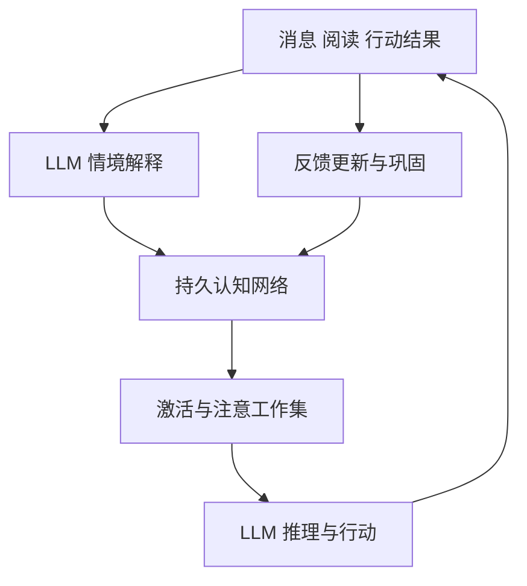

# 小夏认知网络的理论机制与 Codex 实验设计

> v1.1 参考版：本稿保留原研究的机制、数据、阅读范围和候选实验。项目交付是不变量；算法、模型、参数、模块、训练与实验安排均可调整、组合、替换或放弃。旧代码接入点和“第一版”安排是候选建议，不构成施工边界。以项目合同 v1.1 和 README_CODEX_REFERENCE 为准。

小夏的主架构实验应沿着你提出的方向推进：**LLM 承担语言理解和复杂推理，持久认知网络承载经历、概念、目标、注意状态和可学习的选择倾向。** 每次真实经历不仅增加一条记录，还能改变以后怎样联想、判断和行动。

最值得先实现的组合是：经历与概念双层网络、按真实时间变化的激活、事件评价、情境化效用学习，以及快慢记忆巩固。第一版保留主 LLM，先让外部认知状态形成可观察的学习闭环。

日期：2026 年 11 月 3 日。代码对照版本为 [xiaoxia 406e86e](https://github.com/xxu29958-jpg/xiaoxia/blob/406e86e878fbe0a6c78649071cb469c11280e5a2)。本稿聚焦认知主干；全项目其他方向接续[小夏全项目理论依据与 Codex 实现路线](https://chatgpt.com/space/page_0e6c3d37d15081918b64ea31273bc1be)。

# 主架构与三个时间尺度

认知架构决定各部分如何共同工作；神经符号方法连接开放语言和可操作的概念关系；持续学习决定经历怎样改变将来的选择。这三个方向共同服务于同一个运行循环。

| 方向 | 在小夏中的职责 | 优先机制 |
| --- | --- | --- |
| Cognitive Architecture | 组织当前情境、注意、目标、记忆和行动 | ACT-R 激活、LIDA 工作状态、EMA 事件评价 |
| Neurosymbolic AI | 把语言理解连接到概念、关系和可查询状态 | 经历与概念图、结构化操作、时间化关系 |
| Continual Learning | 根据结果修订选择倾向和长期理解 | MemRL 效用更新、CLS 巩固、代表性回放 |

[Standard Model of the Mind](https://onlinelibrary.wiley.com/doi/epdf/10.1609/aimag.v38i4.2744) 将工作记忆、陈述记忆、程序记忆和行动组织在同一框架里，并让符号关系携带激活、频率、效用等数值。[LIDA](https://ccrg.cs.memphis.edu/assets/papers/2013/franklin-ieee-tamd11.pdf) 进一步区分当前激活与长期基础激活，用注意竞争决定哪些内容进入共享工作状态。这为小夏提供了结构依据：图中的关联必须参与当前选择。

## 状态更新的快慢

| 时间尺度 | 保存什么 | 何时变化 |
| --- | --- | --- |
| 快 | 当前输入线索、局部激活、候选解释、工作集 | 新消息、阅读结果、工具结果 |
| 中 | 对话焦点、未完成目标、当前事件评价、跨事件 mood | 情境解释变化、目标进展、时间流逝 |
| 慢 | 长期关联强度、可修订概括、兴趣结构、策略效用 | 重复经历、可归因反馈、新旧经历巩固 |

“快、中、慢”首先规定更新原因和相对速度，不预先把每类状态锁死为某个秒数。一次事件可以迅速改变当前反应；稳定的习惯和理解通过更长期的积累形成。



工作集仍通过模型上下文传入。关键变化在于它由持续演化的状态计算产生，并与后续学习相连。LLM 可以继续检索、提出新关联和解决图中从未出现的问题。

# 节点 关系与状态语义

第一版使用具有业务意义的节点，不需要模拟生物神经元。核心节点是具体经历、概念和目标；行为方案可以先作为带效用的记录，后续再决定是否图化。

| 对象 | 最小内容 | 用途 |
| --- | --- | --- |
| Episode 经历 | 原始内容或引用、来源、发生时间、获知时间、事件 ID | 保留具体语境，支持重新理解 |
| Concept 概念 | 名称、语义表示、关联经历、可修订概括 | 连接分散的经历 |
| Goal 目标 | 目标内容、相关对象、进展、当前状态 | 让注意与行动有连续方向 |
| Relation 关系 | 两端节点、关系类型、来源、有效时间、关联强度 | 表示关于、支持、冲突、先后、关联目标等 |
| Decision 决策记录 | 所用工作集、动作、引用的节点、结果或反馈 | 连接一次选择和后续学习 |

[HippoRAG 2](https://arxiv.org/html/2502.14802v2) 的关键做法是让概念与原文段落共同进入图。其三项多跳任务消融中，完整模型的平均 Recall@5 为 87.1，去掉原文节点后为 81.0。对小夏的直接启发是：概念下面保留具体经历，检索可以沿概念找到旧事，也可以从旧事发现新的概念关联。

## 四类数值分别负责什么

| 状态 | 回答的问题 | 更新依据 |
| --- | --- | --- |
| activation | 此刻是否容易想到它 | 当前线索、时间、关联传播 |
| evidence 与 validity | 这项理解由什么支持，何时成立 | 新观察、明确修订、来源与时间 |
| utility | 在这类情境下，用它是否有帮助 | 任务结果或可归因反馈 |
| stability | 这项长期模式应多快改变 | 经验覆盖、稳定性、反例和近期变化 |

这几个量应分别存储。想起一件事会增加熟悉度；新增独立观察才增加独立证据。一条失败经历也可能因为提供了好教训而有较高效用。

[Zep](https://arxiv.org/html/2501.13956v1) 把经历、事实和概括连接起来，并区分事实的有效时间与系统获知时间。小夏可以据此保存“过去如此、后来改变”的关系。时间有效性负责解释现实变化，激活负责控制当前可及性，两者独立更新。

关联边也应带类型。同一次对话中出现的两个概念可以形成共现关联；“导致”“支持某结论”等关系需要各自的语义和出处。强关联首先影响联想，不自动升级为因果关系。

# 激活 遗忘与线索唤回

自然遗忘应成为正常动力学：久未使用的细节逐渐不易想起；合适线索能重新唤起旧事；反复使用和巩固使部分内容保持更久。

[ACT-R](https://www.andrew.cmu.edu/course/85-412/readings/INTEGRATED.NEW.2002=FINAL.pdf) 用基础激活和当前线索共同决定记忆的可及性：

```math
A_i=B_i+\sum_j W_jS_{ji},
\qquad
B_i=\ln\sum_k t_k^{-d}
```

这里，t_k 是距第 k 次学习或使用经过的时间；d 控制衰减；W_j 是当前线索的注意权重，S_ji 是线索到记忆的关联强度。它把时间、复用和情境联想接到同一机制上。论文中的具体参数服务于其认知实验，小夏应在自己的情境序列上拟合。

## 原型中的计算步骤

1. 用词法和语义匹配找到当前输入的种子节点，同时加入相关的未完成目标。

2. 按真实经过时间计算长期基础激活，不依赖程序运行了多少个循环。实现时固定时间单位，并为刚发生的事件使用正的最小间隔。

3. 在有限子图上沿带类型的关系扩散；对高度泛化、连接过多的节点处理注意稀释。

4. 以注意预算和阈值选择工作集，保存入选原因和关系路径。

5. 当现有工作集不足以解释问题时，允许 LLM 扩展检索或形成新的候选解释。

先使用 Personalized PageRank 作为图检索基线，再在同一张图上比较带时间先验与竞争机制的动态激活，不叠加两套扩散结果。[SYNAPSE](https://arxiv.org/html/2601.02744v3) 提供了经历与概念图上的扩散、fan effect、竞争和阈值方案，适合做后一组候选实现。

其中要分清三个“时间”：

- 过去使用至今的间隔，控制长期可及性。

- 两个事件之间的时间距离，控制事件邻近关系。

- 一次查询中的扩散迭代，控制激活传播与收敛。

SYNAPSE 的查询内衰减项属于第三类，其时间边权中的事件间隔属于第二类；长期遗忘仍需第一类真实时钟。让程序离线一周再启动，应与经过同样一周但没有新事件的持续运行得到相应的时间状态。

## 初始关联如何形成

[Embedding ACT-R](https://www.frontiersin.org/journals/language-sciences/articles/10.3389/flang.2026.1721326/full) 用语言表示的相似度构建关联，并加入 fan 效应，说明向量语义可以接入经典激活模型。它的实证任务是词汇启动和反应时预测。工程上可以先用 embedding 提供关联先验，再让实际经历及反馈调整连接。

为避免“越被检索越垄断”，将候选命中、进入工作集、被用于一次决策、明确复习分成不同事件。候选命中不自动强化基础激活。首版按可观察的使用记录更新，保留复习来源。

细节的可及性与概括的可及性可以采用不同衰减速度。例如，一次讨论的逐字措辞淡去，讨论形成的条件性理解仍可保留。归档与存储清理是独立的容量策略。

# 情绪评价如何参与认知

[EMA](https://stacymarsella.org/publications/pdf/EMA_Dynamics.pdf) 的核心是：情绪随“这件事对目标意味着什么”的解释变化而变化。它区分情境推理和评价；解释形成后，相关性、目标促进或阻碍、结果可能性、意外、归因、可控性等维度形成 appraisal frame。情绪再影响注意和应对方式。

对小夏，LLM 负责理解事件及其与目标的关系；运行时保存这种理解和评价，使其可以持续、修订，并影响以后的选择。

## 最小事件评价记录

```text
AppraisalFrame
  event_id
  interpretation_revision
  related_goal_ids
  relevance
  goal_congruence
  expectedness
  agency
  controllability
  resolution_state
  source_episode_ids
```

这是一份候选接口，不要求所有维度一开始都量化到很细。首版优先接通“相关目标、促进或阻碍、可控性、是否已解决”。

同一事件补充了新信息，就修订同一个 frame。事件解决后调整它对当前情绪的贡献。重新想起旧事可以改变当前体验，但应记录为一次唤回或新的解释，不能把原事件重复计成又发生了一次。

跨事件 mood 由仍有影响的评价共同形成。EMA 原文通过情绪 frames 的聚合与调整实现这一层；若工程上采用时间权重或平滑，作为独立候选与该基线比较。

## 下游消费

情绪状态至少影响三处，才能成为认知机制：

- 注意：哪些目标、经历和线索优先进入工作集。

- 行动：继续了解、提供帮助、换话题、稍后再提等候选如何排序。

- 表达：回应强度、节奏以及文字和语音的表达选择。

一个设计样例：最初把沉默解释为话题不合适；获得“刚才忙着处理事情”的新信息后，修订原解释，对该话题的负面判断也随之调整。关键测试是重新理解是否改变了后续选择，而不只是换了一句情绪描写。

# 反馈学习与快慢巩固

## 先学习外部选择策略

[MemRL](https://arxiv.org/html/2601.03192v2) 将冻结的 LLM 与可学习的记忆选择策略分开。先召回语义相关候选，再利用效用估计选择；得到结果后更新效用。其基础更新形式之一为：

```math
Q_{\mathrm{new}}=Q_{\mathrm{old}}+\alpha(r-Q_{\mathrm{old}})
```

论文的留出任务平均成功率由 MemP 的 0.766 提升到 MemRL 的 0.794。它为小夏提供了直接实验入口：保持主模型，学习外部经验的选择方式。

小夏的原型将效用细化为“某经历或策略在某类情境中的帮助程度”，而不是给每段记忆永久打一个全局好坏分数。首批反馈分三类处理：

| 反馈 | 更新对象 | 结果解释 |
| --- | --- | --- |
| 明确事实或偏好修订 | 对应关系及其有效时间 | 更新理解的内容 |
| 对主动话题的明确评价 | 情境化话题或时机效用 | 学习何时适合提及 |
| 工具任务实际结果 | 相应经验或行动策略效用 | 学习哪些方法帮助完成目标 |

沉默记录为反馈缺失。语义与目标相关性先限定候选，效用随后参与选择；给相关的新经历保留试用机会，以免早期高分经历长期垄断工作集。

一条回答可能涉及多个节点。记录提供给模型的节点、动作引用和可观察结果；用移除或替换关键记忆的对照检查贡献。第一版只更新能明确归因的部分，不把整个回答的奖惩广播到所有召回节点。

## 让具体经历形成长期理解

[Complementary Learning Systems](https://sites.socsci.uci.edu/~lpearl/courses/readings/McClellandEtAl1995.pdf) 提供快慢系统的理论基础：快速保存具体经历，通过新旧经历交错学习逐渐提取共同结构。小夏可以把它转化为两条不同速度的路径：

- 快路径保存刚发生的聊天、阅读、动作和结果，立即可供检索。

- 慢路径从多次经历提炼带条件的理解、兴趣联系和可复用方法。

一次巩固应产生可修订的概括，并关联支持经历、相反经历和适用条件。设计样例是“夜班后更偏好简短交流”，而不是无条件的“永远不喜欢长回复”。新反例进入后修订条件，既有概括仍可继续演化。

回放采样同时覆盖新经历、旧的代表经历、最近反例和正在变化的目标。回放沿用原 episode ID，次数改变熟悉度，不增加独立事实来源数。

## 后续可训练模块

第一版可用外部数值更新完成闭环。有足够反馈后，再训练小型相关性打分器、话题选择器或评价器。

[On Tiny Episodic Memories](https://arxiv.org/pdf/1902.10486) 提供简单经验回放的强基线；[EWC](https://arxiv.org/pdf/1612.00796) 用参数重要性限制破坏旧技能的更新；[MER](https://arxiv.org/pdf/1810.11910) 通过新旧梯度的相容性兼顾迁移与干扰。它们进入小模块训练的对照组，不必套进首版 Q 表。

如果后续需要把延迟反馈分配到关联边，可研究三因素学习中的 eligibility trace。[Frémaux 与 Gerstner 的理论综述](https://www.frontiersin.org/journals/neural-circuits/articles/10.3389/fncir.2015.00085/full) 描述了局部活动痕迹与后续调制信号的结合。候选局部规则为：

```math
\Delta w_{ij}=\eta\,\delta_t\,e_{ij}(t)
```

e_ij 标记近期参与的连接，delta 表示相对同类情境预期的结果。应用顺序是先检验记忆选择效用，再研究边的信用分配；不要同时开放全部参数，以免实验无法定位改善来自哪里。

# 神经符号接口怎样保留 LLM 的能力

[NS-CL](https://jiajunwu.com/papers/nscl_iclr.pdf) 将神经表示、语义解析与可组合操作连接起来，并通过任务结果训练概念对应关系。对小夏，值得借用的是这一接口思想：LLM 将开放语言解释为候选经历、关系、目标与操作，网络提供持久状态及结构查询，复杂推理和自然表达继续由 LLM 完成。

初始操作可以很少：查找经历、追踪来源、关联概念、修订关系、更新目标、提交反馈。概念和关系的内容保持开放，不要求开发者提前列出所有话题。

需要明确组合推理的局部问题再考虑 [Logical Neural Networks](https://arxiv.org/pdf/2006.13155)。其节点对应逻辑式，数值表示真值边界和连接作用，可以进行双向推理与学习。适合探索条件组合和冲突解释，不作为普通聊天每句话的强制通道。

## 给强模型留出的空间

- 工作集是当前材料和选择倾向，模型仍可以提出新解释。

- 现有网络没有答案时，允许补充检索、推理和创建候选关联。

- 行为方案先作为可选经验，而非逐句话术模板。

- 自由文本、原始经历与结构化关系并存，避免在建图时丢掉语境。

- 在预算相同的实验中比较网络是否帮助了强模型，保留它原本擅长的新问题推理。

这一分工允许理论规定“状态如何形成和更新”，让模型继续发挥“怎样理解眼前新问题”的能力。

# 现有代码的接入位置

下列判断对应固定版本 406e86e，文件位于 `data/plugins/astrbot_plugin_ada_companion/`。

| 代码位置 | 已有行为 | 认知原型接入方式 |
| --- | --- | --- |
| [temper.py](https://github.com/xxu29958-jpg/xiaoxia/blob/406e86e878fbe0a6c78649071cb469c11280e5a2/data/plugins/astrbot_plugin_ada_companion/temper.py) | 根据当前消息及最近回复生成少量当轮表达提示 | 新增持久 appraisal 与 mood；现有提示作为对照，不把它当长期情绪存储 |
| [prompting.py](https://github.com/xxu29958-jpg/xiaoxia/blob/406e86e878fbe0a6c78649071cb469c11280e5a2/data/plugins/astrbot_plugin_ada_companion/prompting.py) | ContextBuilder 组合材料、共享历史、记忆，并以临时 TextPart 加入 temper 提示 | 让工作集投影进入已有上下文构建路径 |
| [owner_memory.py](https://github.com/xxu29958-jpg/xiaoxia/blob/406e86e878fbe0a6c78649071cb469c11280e5a2/data/plugins/astrbot_plugin_ada_companion/owner_memory.py) | 维护跨渠道身份，按原生 scope 调用记忆桥接并组合历史 | 保留身份与来源逻辑，认知状态放入记忆状态层 |
| [main.py](https://github.com/xxu29958-jpg/xiaoxia/blob/406e86e878fbe0a6c78649071cb469c11280e5a2/data/plugins/astrbot_plugin_ada_companion/main.py) | 已装配 DialogueState、MemoryTools、ContextBuilder、ProactiveChat 和 InterestMaterials | 在既有装配点接入一个认知运行时，不另建一套主动调度 |
| [initiative.py](https://github.com/xxu29958-jpg/xiaoxia/blob/406e86e878fbe0a6c78649071cb469c11280e5a2/data/plugins/astrbot_plugin_ada_companion/initiative.py) 与 [initiative_materials.py](https://github.com/xxu29958-jpg/xiaoxia/blob/406e86e878fbe0a6c78649071cb469c11280e5a2/data/plugins/astrbot_plugin_ada_companion/initiative_materials.py) | 主动决策使用线程、记忆和阅读材料，发送前复核当前状态 | 从认知网络获取目标及候选排序，继续由现有执行链消费 |

`owner-links.json` 承担身份链接，不能充当认知图。项目已经有 `astrbot_plugin_memory_companion` 及记忆桥接，具体持久化位置应沿该层现有存储确认，避免产生第二份互不一致的记忆权威。

## 最小接口提案

```python
observe(event, interpretation=None) -> StateDelta
activate(cues, state, now, budget) -> Workspace
feedback(decision_id, outcome) -> LearningDelta
consolidate(episode_ids, state, now) -> StateDelta
```

这些是逻辑接口，第一版可以处于一个小模块中。

`Workspace` 至少包含选中的经历与概念、相关目标、简短评价状态、来源和选择分量。`StateDelta` 记录针对哪个事件、哪一版状态的更新。相同事件再次送达时读取已有结果，不重复强化。

## 一次交互如何运行

1. 保存真实输入及事件 ID，用已有语义表示产生初步线索。

2. 从现有状态激活工作集，交给主 LLM。

3. LLM 结合新输入解释情境、推理和回应；需要更多材料时使用检索操作。

4. 将结构化解释、目标变化及可观察动作写入认知状态。

5. 后续真实结果通过决策 ID 更新相应效用。

6. 空闲时选取新旧经历巩固，产出新的概括版本。

需要当轮重新检索的复杂事件，可以在解释后再激活一次。简单回复不强制增加第二次模型调用，更不为每个图节点发起 LLM 调用。

原型只在相关子图上计算，显式配置活动节点、扩散步数、上下文和后台巩固预算。先测量这些量的影响，再决定具体阈值和存储优化。

# 对照实验与验收

研究问题是：长期内部状态的变化，是否持续改善小夏的注意、联想、理解和行动？

固定主模型版本、系统模板、输入序列和上下文预算。每个情境家族分为开发版本与留出版本，留出版本改写措辞或更换表面主题；记录随机设置和状态快照。

| 组别 | 增加的机制 | 回答的问题 |
| --- | --- | --- |
| A | 现有上下文与记忆路径 | 当前能力基线 |
| B | 同一材料的经历与概念图，加 PPR | 结构关联是否有用 |
| C | 同图改用真实时间先验与动态激活 | 自然遗忘与线索唤回是否改善选择 |
| D | C 上增加情境化效用学习 | 结果反馈是否改善后续选择 |
| E | D 上增加新旧混合巩固 | 是否形成可迁移、可修订的长期理解 |

情绪评价单独做开关对照，分别放在 C 或 D 上比较。不要让一次版本同时增加情绪、模型大小、上下文和记忆容量。

## 八类核心情境

| 情境 | 观察什么 | 实现上的判据 |
| --- | --- | --- |
| 自然遗忘 | 细节随间隔降低可及性，重要概括保持更久 | 用可控时钟比较曲线；关机期间按实际经过时间演化 |
| 线索唤回 | 无直接关键词时能否通过经历和概念找到旧事 | 同时检查正确关联与无关串联 |
| 解释修订 | 新信息改变对同一事件的理解 | 原 appraisal 修订，后续注意或行动随之变化 |
| 反馈学习 | 以前无效的选择是否减少 | 改善出现在相似的新情境，不只原句重放 |
| 条件性巩固 | 多次经历能否形成有条件的概括 | 新反例能修订适用范围 |
| 事实变化 | 过去与当前关系是否正确使用 | 时间问题得到相应版本 |
| 状态恢复 | 已学倾向是否跨重启延续 | 恢复快照延续，重置快照消失；重复事件只学习一次 |
| 开放新题 | 网络没有已有模式时能否正常推理 | 与同模型基线比较完成质量和额外开销 |

设计样例：歌曲线索连接到一次具体聊天，再连接到当时尚未完成的计划。改变歌曲表述仍能找到这条经历；一个只有相同音乐词汇、没有共同经历的输入，不应强行触发同一计划。评价的是有理由的关联。

## 必须同时记录的结果

记录候选集、工作集、相关目标、采用的来源、动作、结果以及状态变化；这些是可观察的决策证据，不要求保存模型的私有推理过程。

质量指标包括跨经历关联正确性、无关关联率、新情境迁移、事实修订使用、主动话题适切性。工程指标包括端到端和新增 P95 延迟、模型调用量、活动子图大小、长期存储增长及恢复一致性。

先用小批量人工逐例复核发现机制问题，再扩大到足够多的独立情境；对随机生成做重复试验，报告差值及不确定性。是否晋升由目标能力、旧能力保持和资源成本共同决定。遗忘相关指标按线索强弱、时间和记忆类型分组，不以“所有细节永久答对”作为目标。

# 论文阅读索引与采用顺序

以下 16 项对应原文的方法、相关公式、实验或理论论证。前十项支撑首轮认知原型；后六项用于接口比较与下一阶段学习机制。

## 认知主干与记忆机制

| 论文 | 核读位置 | 小夏应取用的部分 |
| --- | --- | --- |
| [An Integrated Theory of the Mind](https://www.andrew.cmu.edu/course/85-412/readings/INTEGRATED.NEW.2002=FINAL.pdf)，2004，链接为作者早期稿 | 陈述记忆、激活方程、fan effect、规则效用 | 时间与复用形成基础激活，当前线索驱动联想 |
| [LIDA A Systems-level Architecture for Cognition Emotion and Learning](https://ccrg.cs.memphis.edu/assets/papers/2013/franklin-ieee-tamd11.pdf)，2014 | III、VI、VII、VIII、X | 当前与长期激活、注意竞争、共享工作状态；情绪学习部分含概念设计 |
| [EMA A process model of appraisal dynamics](https://stacymarsella.org/publications/pdf/EMA_Dynamics.pdf)，2009 | 2.3.2–2.3.5 | 解释、评价、mood、注意与应对的循环 |
| [A Standard Model of the Mind](https://onlinelibrary.wiley.com/doi/epdf/10.1609/aimag.v38i4.2744)，2017 | Structure and Processing、Memory and Content、Learning | 符号关系与可学习数值状态的组织方式 |
| [Integrating language model embeddings into the ACT-R cognitive modeling framework](https://www.frontiersin.org/journals/language-sciences/articles/10.3389/flang.2026.1721326/full)，2026 | 2.2–2.3 与结果部分 | 向量语义接入关联强度；实证为词汇启动任务 |
| [From RAG to Memory](https://arxiv.org/html/2502.14802v2)，HippoRAG 2，ICML 2025 | 3–6、附录 G、表 4 | 概念和原文共同入图，PPR 作为联想基线 |
| [Zep A Temporal Knowledge Graph Architecture for Agent Memory](https://arxiv.org/html/2501.13956v1)，2025 | 2–4 | 来源关系、有效时间与获知时间 |
| [Synapse Empowering LLM Agents with Episodic-Semantic Memory via Spreading Activation](https://arxiv.org/html/2601.02744v3)，2026 预印本 | 3.1–3.4、4.3 | 动态扩散、竞争、阈值；与时间先验分开验证 |
| [Why There Are Complementary Learning Systems in the Hippocampus and Neocortex](https://sites.socsci.uci.edu/~lpearl/courses/readings/McClellandEtAl1995.pdf)，1995 | 快慢学习、交错训练、巩固论证 | 经历快速保存，长期结构逐步形成 |
| [MemRL Self-Evolving Agents via Runtime Reinforcement Learning on Episodic Memory](https://arxiv.org/html/2601.03192v2)，2026 预印本 | 3–5、附录 A、G.1–G.2 | 冻结主 LLM 的外部效用学习；多记忆信用分配是需继续细化的点 |

## 神经符号与后续学习方法

| 论文 | 核读位置 | 采用条件 |
| --- | --- | --- |
| [The Neuro-Symbolic Concept Learner](https://jiajunwu.com/papers/nscl_iclr.pdf)，ICLR 2019 | 3.1–3.2、4.1–4.2 | 借用语言到可组合概念操作的接口，原实验为视觉推理 |
| [Logical Neural Networks](https://arxiv.org/pdf/2006.13155)，2020 | 3–4、6–7 | 局部条件组合、真值边界和软逻辑实验 |
| [Overcoming catastrophic forgetting in neural networks](https://arxiv.org/pdf/1612.00796)，PNAS 2017 | 参数重要性方法、公式 3、顺序任务实验 | 有可训练小模块后比较重要参数保护 |
| [Learning to Learn without Forgetting by Maximizing Transfer and Minimizing Interference](https://arxiv.org/pdf/1810.11910)，ICLR 2019 | 2–3、Algorithm 1、实验 | 研究新旧梯度的迁移与干扰 |
| [On Tiny Episodic Memories in Continual Learning](https://arxiv.org/pdf/1902.10486)，2019 | 3–5 | 小型代表性回放作为训练强基线 |
| [Neuromodulated Spike-Timing-Dependent Plasticity and Theory of Three-Factor Learning Rules](https://www.frontiersin.org/journals/neural-circuits/articles/10.3389/fncir.2015.00085/full)，2016 理论综述 | 4–5，尤其 eligibility trace 与延迟反馈 | 后续关联边信用分配的机制来源 |

# Codex 第一轮任务

先交付一个能跑完整因果链的原型：**同一主模型、同一系统模板，因为经历不同，产生不同且有理由的工作集和选择；反馈改变下一次选择；状态恢复后这种变化仍然存在。**

实现顺序是经历与概念图、激活和时间、工作集接入、明确反馈驱动的效用更新。并行建立事件解释与 appraisal 的状态结构；在独立对照里接入注意和行为。最后加入新旧经历巩固，比较是否带来跨情境迁移。

交付内容应包括：

1. 最小状态模型及四个接口，接在现有记忆和上下文路径。

2. 一个跨多次交互的可运行情境，展示状态如何改变注意与选择。

3. 可控时钟、快照恢复、事件去重和 appraisal 修订测试。

4. A 至 E 的同预算对照，以及至少一组模块关闭实验。

5. 每项改善对应哪条机制、哪些情境受益、资源增加多少的结果说明。

框架、数据库和模型选型由现有代码与实验结果决定。首轮的交付重点是让经历真正参与后续认知；后续再按结果选择可训练排序器、局部软逻辑或更细的关联学习。

