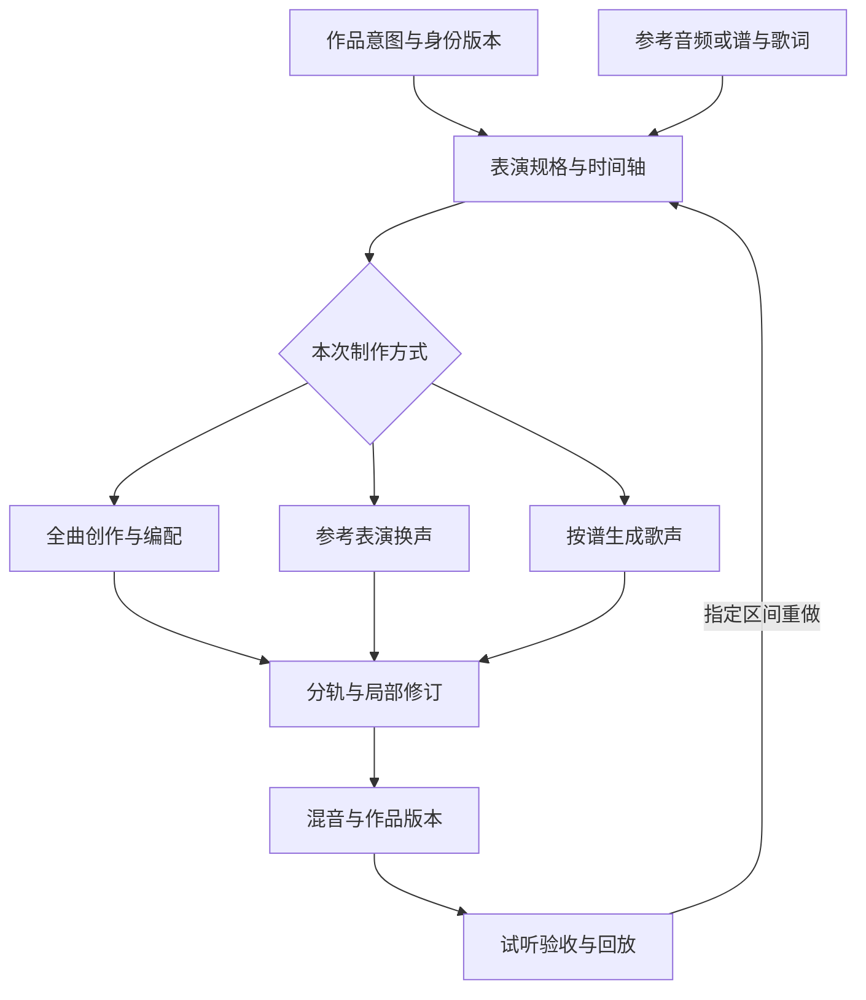
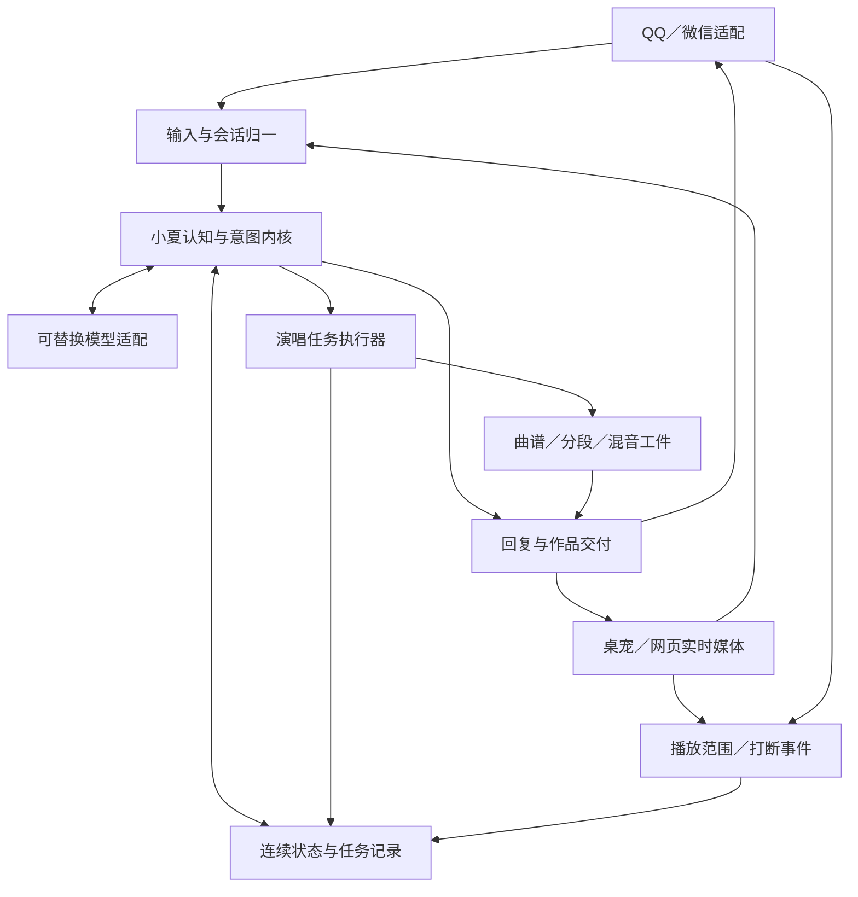

# 小夏：演唱／戏曲与基座专项 v1.2

更新：2026-11-04（北京时间）。供 Owner 裁决与 Codex 后续实现使用。

> 项目交付是不变量；论文、模型、算法、内部表示、框架与部署拓扑可改。采用新机制是为了改善实际体验；有更好证据时可以组合、替换或放弃旧方案。完整演唱和已约定能力继续保留，新增创作与精细编辑列为候选，采纳后再进入交付验收。

## 一页结论

**唱歌与戏曲需要独立专项，基座采用“成熟模型与工具 + 小夏自有的连续认知／交付内核”。**

统一的是小夏的身份、经历、目标、声音锚点与作品；底层既可以由专业模型协作，也可以逐步合并成统一声音模型。这种统一不要求每种模型共用同一组参数或相同 speaker embedding。

建议的起步组合：

| 层 | 推荐起点 | 自己掌握什么 |
|---|---|---|
| 语言理解与推理 | 当前已接入的强云端 LLM；模型可比较替换 | 工作集、目标、记忆更新、工具与结果语义 |
| 认知与状态 | 自有 Python 领域模块；复用现有状态／持久化能力 | 共同经历、关系、关注、反馈与有效版本 |
| 渠道 | AstrBot 继续承担 QQ／微信接入 | 跨渠道身份、作品归属、消息能力和投递结果 |
| 连续语音 | LiveKit Agents 候选；Pipecat 为轻量替代 | 实际播放、话轮、打断、恢复和唱后回聊 |
| 歌唱与戏曲 | SoulX-SVC／SVS、Seed-VC、DiffSinger／OpenUtau 按任务比较 | 作品版本、词谱与表演计划、声音身份、完整作品验收 |
| 新作品创作 | ACE-Step 1.5 作为首个比较候选 | 创作意图、结构、修订与成品；本项为增强探索线 |
| 任务运行 | 单机 Python + SQLite／现有 SQLAlchemy；GPU 依赖隔离 | 作业、阶段工件、取消、恢复、资源和真实交付 |
| 后续编排 | 复杂认知流程可选 LangGraph；跨机长任务可选 Temporal | 业务状态不由框架的私有 checkpoint 代管 |

这是推荐组合，不是必须全装的依赖清单。单机桌宠若 Pipecat 更省事，或统一声音模型在听审和资源上胜出，直接依据证据改选。

## 为什么演唱需要独立能力线

普通说话由语言语义主导韵律，歌唱要满足旋律与节奏，戏曲还要处理剧种、字音、行当、板式与表达性变化。需要分别控制和验收三个问题：

1. 谁在唱：小夏声音身份是否贯穿说话、歌唱、念白与不同音域。
2. 唱什么：作品／版本、歌词、段落、旋律、节奏与伴奏是否正确完整。
3. 怎样唱：轻重、气口、滑音、颤音、拖腔、角色和剧种特点是否成立。

论文给出的有用机制是时长与风格联合预测、细粒度音素／音高条件、局部错误建模和配对数据。项目将这些机制作为候选，不要求同时复现每篇网络结构。

## “自己写基座”该写到哪里

**自有是掌握数据与语义，不是每层都从零制造。**

建议自己写／整理：经历与认知更新、跨渠道人物映射、声音与作品版本、交付状态、可恢复作业、资源调度、评价与反馈归属。已有 shared_core、投递策略与本地语音接口继续复用，按真实变更影响逐步收敛。

建议复用：预训练 LLM、ASR、TTS、SVC／SVS、声码器、人声分离、F0 提取、歌词／谱对齐、音乐编辑器、数据库、音频编解码和实时媒体协议。专用缺口先做数据与适配实验；目标剧种／音域持续不达标时，才投入专用适配器或声学模型训练。

认知成长可以发生在三处：持久经历与关联更新；按反馈调整情境策略；在合格数据上训练专用参数。三种路线可独立试验，不要求每次相处都更新大模型权重，也不固定永远不训练。

## 当前仓库与这次工作的关系

已读默认分支快照为 `8c63aff5a18fcccd624ad0f29ee70f303e15975b`。[GOAL 原文](https://github.com/xxu29958-jpg/xiaoxia/blob/8c63aff5a18fcccd624ad0f29ee70f303e15975b/GOAL.md) 记录 Fish S2 + Seed-VC 候选已切换，按用户要求暂停继续打磨。此次交付仅补研究、架构图和合同，没有实施新模型或修改仓库。

公开配置提供 `chatgpt-companion` 别名及多种模型候选，实际主聊天模型由运行配置选择。因此推荐强云端主推理接口，而不把公开列表首项误写成当前运行型号。

本轮证据包含：7 篇正式演唱／戏曲会议论文的方法与实验阅读；专业模型技术报告；官方代码、模型卡与运行文档。另补统一声音方向。此前的全项目、认知、语音聊天研究及 91 项文献母册继续保留。论文分数是原实验结果，本机候选尚需按合同实测。

## 怎样从研究进入下一轮工作

首个优先纵切建议是：**用户点一首完整作品 → 可查询制作进度 → 小夏声音完成演唱 → 真实可播／可收 → 重启后作品与状态仍在 → 继续聊天。**

把声学上限与自主链路分开测：给准确词谱时唱不好，重点查渲染／数据；给准确词谱能唱好而点歌失败，重点查选版、准备、对齐和编排。这比不断换一个“更大模型”更容易找到真正的瓶颈。

精细局部编辑、自动创作、实时对唱是有价值的增强候选。先保留试验空间，不让新功能悄悄变成原完整演唱的额外交付门槛。

---

# 小夏 v1.2：唱歌与戏曲专项研究补充

日期：2026-11-04。正式会议论文的方法、实验与项目取舍。

## 结论

**需要独立专项，但应作为小夏统一声音表达系统中的能力域，而不是再造一个人格或另起一套聊天产品。** 聊天、朗读、哼唱、歌曲、戏曲共享小夏的声音身份、交互会话与长期偏好；各自可采用最合适的模型。长期可试验统一说唱模型，近期也允许专业渲染器协作。

原专项交付是完整指定作品与戏曲，以及贯穿说话、歌唱和念白的声音身份。给词给谱、精细改字改腔和全曲原创作为可探索增强项，Owner 采纳后进入相应验收；现阶段可按纠正重做完整作品。戏曲交付需声明覆盖的剧种、方言和行当，并完成相应完整唱段。模型、方法、控制字段和下列论文均为可替换候选；替换以目标旅程、听感与实测结果裁决。

### 能力与输入分工

| 能力 | 核心输入 | 适用用途 | 要独立验证的部分 |
|---|---|---|---|
| 歌声转换 SVC | 已有演唱 + 目标声音参考 | 快速保留原表演的音高、节奏与唱法，换成小夏音色 | 源歌手音色残留；转音、辅音和高音损伤 |
| 可控演唱 SVS | 歌词 + 曲谱/旋律 + 表演条件 | 指定曲目、改词、清唱、逐句改腔 | 音素时长、咬字、音准、技巧与身份稳定 |
| 全曲生成 | 创作意图/歌词/风格，可带参考 | 新歌、伴奏、完整编曲 | 整曲结构、歌词覆盖、主副歌延续、声部混音 |
| 戏曲表演 | 剧种/方言/行当 + 唱词/曲牌或板式 + 表演参考 | 完整唱段、唱念衔接、角色化表演 | 方言字音、字头字腹字尾、一字多音、行腔与伴奏落点 |

这四项是交付能力的区分，不要求四个大模型，也不要求所有模型一次性安装。原始演唱复制适合 SVC，自主决定怎么唱需要 SVS/生成规划；整曲创作和戏曲角色表达不应被一个短音频示例替代。

## 七篇原论文：已读取的方法和实验

说明：下列数值均为各论文内部实验，不能把不同数据、测试句和听众下的 MOS 直接排成跨论文排行榜。本轮读取了各篇下列方法、数据、主要实验与消融章节；未运行作者代码，未听评作者音频，未把摘要当作已读全文。

### S01 — FT-GAN: Fine-Grained Tune Modeling for Chinese Opera Synthesis

- 会场：AAAI 2024，38(17)，19697–19705；正式主会论文。
- [官方论文](https://ojs.aaai.org/index.php/AAAI/article/view/29943)；[PDF](https://ojs.aaai.org/index.php/AAAI/article/download/29943/31649#page=1)；[作者代码](https://github.com/zhengmidon/Gezi-Opera-Synthesis)。
- 已读：Dataset Construction；Method（Conditioner、Mel Predictor、Discriminator、Losses、Speech Pre-Training）；Experiments；Extensive Experiments；Tables 1–4。
- 机制：歌仔戏数据显式标注元音变形及一字多音；音素与音高分开编码后用 FiLM 融合，Conformer 建模长短依赖，多时长/频带判别器细化频谱。
- 证据：5 位演员、4.54h 闽南语歌仔戏；加入3.77h同方言语音预训练。歌仔戏自然度 MOS 4.18，对照 VISinger2 3.90；去掉元音变形标注后发音 CMOS 为−0.43（Table 3，w/o Vowel Morphing 行、Pro 列，相对完整模型）。京剧扩展因数据少改用真实 F0 输入，不能将该结果当作纯曲谱驱动能力。
- 小夏试验：先比较“普通拼音标注”与“按实唱拆音素/转腔标注”，再决定是否更换声学骨干；观察改标注对字音和长尾腔的收益。

### S02 — Improving Chinese Pop Song and Hokkien Gezi Opera Singing Voice Synthesis by Enhancing Local Modeling

- 会场：EMNLP 2023 main，3302–3312；正式主会论文。
- [官方论文](https://aclanthology.org/2023.emnlp-main.200/)；[PDF](https://aclanthology.org/2023.emnlp-main.200.pdf)；[作者代码](https://github.com/baipeng1/SVSELM)。
- 已读：§2.1–2.3 方法；§3 实验；§4.1–4.4 结果/消融/案例；Limitations；Tables 1–4。
- 机制：音素邻域局部注意力与全局注意力门控融合；对难合成音素区域提高重建损失权重，解决咬字、呼吸与局部噪声。
- 证据：5.89h普通话流行歌曲及4.5h闽南语歌仔戏；10名听众。歌仔戏基线 MOS 3.46±0.15，改进后3.61±0.12；接入 DiffSinger 的同数据结果3.82→3.86，收益较小。
- 小夏试验：把“整体还行但某个字破音/尾腔抖动”作为定位目标，比较局部修复、损失重加权与整体换模型，保留字级错误片段。这里的局部建模是候选修理方法，不应强制加入每个模型。

### S03 — Peking Opera Synthesis via Duration Informed Attention Network

- 会场：Interspeech 2020，1226–1230；语音领域正式主会论文。
- [官方记录](https://www.isca-archive.org/interspeech_2020/wu20d_interspeech.html)；[作者预印本全文](https://arxiv.org/pdf/2008.03029)。
- 已读：§2.1–2.3 方法；§3.1–3.3.2 数据、时长与合成实验；§4结论；Table 1。
- 机制：预测音素时长分布，在音符总时长约束下求解分配；从实唱转写伪谱训练，以容纳转音与颤音。重点是谱面音符与实际演唱不完全相同。
- 证据：2h标注京剧、606唱句；64唱句测试。10ms帧下，BiLSTM-MDN加约束的平均时长误差8.91帧，同网络启发式分配17.15帧；纯曲谱合成 MOS 3.34。
- 小夏试验：单字长腔、多音素同等重要的唱句，对比“拉长主元音”与学习式分配；验收音节内部节奏和戏味，而非只检查最终音频时长一致。

### S04 — Towards Chinese Yue Opera Singing Voice Synthesis: A Benchmark with Dataset, Data Augmentation and Baseline Model

- 会场：Interspeech 2026，1596–1600，DOI 10.21437/Interspeech.2026-131；官方记录和 PDF 已核实。
- [官方记录](https://www.isca-archive.org/interspeech_2026/bai26_interspeech.html)；[PDF](https://www.isca-archive.org/interspeech_2026/bai26_interspeech.pdf)。
- 已读：§2 YOAT 数据/三类增广；§3声学模型；§4实验设置；§5.1–5.3结果；Tables 1–3。
- 机制：吴语越剧发音词典、人工音素对齐、多音高尾腔；给定对齐时长与音高，条件流匹配生成频谱。念白补字音，跨歌仔戏数据补音高/节奏覆盖。
- 证据：单演员小生行当，1.35h/565片段，22测试句；10步模型自然度3.92±0.07，3090上24.678M参数、1296MB、RTF0.0364。加4.5h歌仔戏后F0 RMSE 0.2133→0.1834，自然度3.92→4.01。
- 小夏试验：分开测“给定准确时长/音高”的声学上限和“自动从词谱规划”的产品链路。该模型未预测时长，单剧种小生数据不覆盖所有戏曲行当。

### S05 — TCSinger: Zero-Shot Singing Voice Synthesis with Style Transfer and Multi-Level Style Control

- 会场：EMNLP 2024 main，1960–1975；正式主会论文。
- [官方论文](https://aclanthology.org/2024.emnlp-main.117/)；[PDF](https://aclanthology.org/2024.emnlp-main.117.pdf)；[作者项目](https://tcsinger.github.io/)。
- 已读：§3.1–3.5方法；§4.1–4.3实验/消融；§6局限；附录A.3–A.7、B和C.1；Tables 1–5、7。
- 机制：音色、内容、风格分离；聚类VQ提取音素级风格；Style & Duration LM联合预测风格和时长；扩散预测音高，风格自适应解码器合成。
- 证据：组合 GTSinger 中英子集、M4Singer、OpenSinger、AISHELL-3 与 PopBuTFy，留出40歌手；零样本风格迁移质量/相似度 MOS 4.12/4.28，对照StyleSinger 3.94/4.01。去掉联合时长模型质量/相似度CMOS下降0.12/0.22。训练时长合计在原文中不一致，故不采用合计数（见下方复核记录）。
- 小夏试验：同一个声音参考，换内容与唱法，分别盲评“仍然是小夏”及“表达变化生效”。论文文字控制实际为类别嵌入（两种情绪/两种唱法/六种技巧），自由中文指令需另接解释层。

### S06 — TechSinger: Technique Controllable Multilingual Singing Voice Synthesis via Flow Matching

- 会场：AAAI 2025，39(22)，23978–23986；官方 Proceedings 记录为 AAAI-25 Technical Track on Natural Language Processing I，DOI 10.1609/aaai.v39i22.34571。
- [官方论文](https://ojs.aaai.org/index.php/AAAI/article/view/34571)；[作者全文](https://arxiv.org/pdf/2502.12572)；[作者代码](https://github.com/gwx314/TechSinger)。
- 已读：TechSinger 全部方法小节；Experiments（设置、Main Results、Ablation Study）；Tables 1–5。
- 机制：自然语言→音素级演唱技巧；技巧检测器补标训练数据；流匹配预测F0与细化频谱；音高、时长、技巧共同参与生成。
- 证据：五语言GTSinger子集、自录30h中文及M4Singer；歌唱合成测试804片段。文字提示策略质量/可控性MOS3.85/4.04，随机策略3.78/3.76。音频→音素级技巧检测器的 F1 为0.770（Table 4，whole 行，六种非滑音技巧；滑音按规则判定）；文字提示→技巧预测器另测，FLAN-T5-Large 的 F1 为0.818（Table 3）。
- 小夏试验：让用户说“这一句轻一点、尾字带颤音”，保存生成的局部技巧计划，做同词同旋律对照；纠正应落到时间段和技巧，避免把用户一次偏好变成永久全局音色变化。

### S07 — GTSinger: A Global Multi-Technique Singing Corpus with Realistic Music Scores for All Singing Tasks

- 会场：NeurIPS 2024 Datasets and Benchmarks Track；正式数据集与基准论文。
- [官方论文](https://papers.nips.cc/paper_files/paper/2024/hash/023d2c1a17cf35b11a0cbb43a0677c91-Abstract-Datasets_and_Benchmarks_Track.html)；[PDF](https://proceedings.neurips.cc/paper_files/paper/2024/file/023d2c1a17cf35b11a0cbb43a0677c91-Paper-Datasets_and_Benchmarks_Track.pdf)。
- 已读：§3.1–3.6数据构建与许可；§4.1–4.4四类基准；§5局限；Tables 2–6。
- 机制：同歌手同歌词的自然唱、技巧唱及朗读配对；音素边界、技巧、真实乐谱同步标注。语音—唱歌身份连续与局部技巧控制有明确监督基础。
- 证据：20歌手、9语言、80.59h歌唱及16.16h配对朗读；六种技巧。基准留100首歌，技巧控制StyleSinger MOS-C4.15，对照DiffSinger3.83。
- 小夏试验：建立小而干净的说/唱/技巧对照锚点，按整曲/来源录音分割训练与测试；该数据以流行/美声为主，需另有剧种资料。数据许可CC BY-NC-SA 4.0，作为研究输入与随产品分发应分开核对。

## 从论文转为小夏实现：建议而非冻结架构

下列实验、接口和增强功能都是候选。局部编辑／全曲原创不自动成为原完整演唱目标的新增完成条件；能力范围由合同 v1.2 统领。

### 1. 固定能力目标，接口可演进

可以先提出一个版本化的表演请求，而不是把任何论文内部张量暴露给聊天层。最小信息包括：作品/歌词来源、目标内容、旋律来源、声音身份参考、语言与剧种条件、局部表达意图、是否需要伴奏、可用设备/延迟预算。输出包括可播放音频及与歌词/段落对应的时间线；具体字段由首个可运行纵切修订。

这里分开的是业务含义：

- **作品层**：唱哪一首、哪一段、歌词与版本。
- **表演层**：谁唱、怎样唱、何处换气、哪句改动、伴奏如何进入。
- **渲染层**：选用什么声学模型、采样配置、声码器与混音器。
- **交互层**：用户听到了哪里、何时打断、怎样修改和接着唱。

可以合并服务或共享一个模型；避免把一个`emotion=opera`字符串当作整个戏曲任务的数据表达。

### 2. 基座不是“全自己写”与“套现成模型”二选一

优先复用成熟预训练声学/语言模型及音频运行库；由项目掌握表演请求、身份锚点、内容和时间线、交互取消、任务状态、评测样本与反馈归属。缺口若在方言、念白或行腔，先验证数据适配/微调/小型专用模块的收益。只有既有模型在明确目标上持续失败，才把新声学骨干或训练路线列为研发任务。

统一说唱基座值得实验，但选择标准是“说话像她、唱歌像她、切换不断、设备撑得住”，不是模型结构是否漂亮统一。专业戏曲声学模块可以是共享模型的适配器，也可以是独立后端。作品与身份状态不能绑定某一份模型私有格式。

### 3. 两条试验轨并行，避免拿模型上限冒充产品闭环

| 试验轨 | 控制条件 | 主要定位 |
|---|---|---|
| 声学上限轨 | 人工正确的歌词、音高、时长与声音参考 | 模型能否唱好、发音和音色是否可达 |
| 自主表演轨 | 用户自然语言/曲名/上传曲谱或哼唱 | 系统能否正确解释、规划、合成、混音、播放并接受修改 |

有精细输入时效果好，而自主链路效果差，应优先修词谱、时长、技巧计划或对齐；两条轨都差，再优先修数据、声学模型或声码器。

### 4. 建议任务拆分

1. **声音身份与表演基线**：同一身份完成聊天、朗读、短唱、长音和角色化念白；留音频锚点及盲测对照。
2. **可控演唱纵切**：用户指定歌词/旋律→完整作品或唱段→可回听；采纳增强编辑后再支持改词、转调或局部表达修改，并记录改动范围。
3. **戏曲纵切**：选定首批剧种/方言/行当，建立字音与行腔材料，完成唱、念与衔接；扩展剧种由用户价值和数据可得性排序。
4. **完整作品与交互**：长段落一致、伴奏对齐、段间衔接；演唱中被打断能及时止声，再恢复时不重复已听内容。
5. **反馈学习**：“错字音”“调高了”“这里拖长”“不像小夏”“这句唱法我喜欢”分别进入不同改进路径；保留原作品、原表演和改进版本。
6. **部署与生命周期**：5070 Ti 16GB上实测常驻/按需装载/离线渲染三策略；同时考察聊天存活、显存峰值、冷启动、任务中断恢复和作品导出。

各阶段以可使用旅程验收，不以复现论文分数或堆满模块验收。性能阈值随目标设备基线和用户体验共同确定，论文设备数据仅用于安排试验优先级。

### 5. 完成交付应有的证据

| 交付关系 | 证据要求 |
|---|---|
| 内容正确 | 歌词/念白漏字、重复、错读可定位；方言由适合的标注或听评校验 |
| 旋律与表达 | 固定旋律下改技巧有效；转音/颤音依表演目标评价，不能一概作为音准误差扣分 |
| 声音连续 | 同一人不同任务/音区/情绪的盲听身份相似度，辅以声纹指标 |
| 长作品完成 | 完整歌曲或完整唱段回听；段落结构、呼吸、声线、响度、伴奏对齐持续稳定 |
| 可交互 | 打断→停止实际播放；采纳精细编辑后定位修改→局部重渲染；重启→作品、任务和反馈状态可恢复 |
| 可维护替换 | 换声学模型仍能消费原作品与表演请求，保留原始资料和结果比较 |
| 不靠挑样本 | 保存全部测试输出、失败片段、配置、模型版本、数据切分；同条件比较后更新候选 |

## 定点复核记录

- **S01 元音标注消融**：FT-GAN Table 3 的 Pro/Nat/Exp/Con 列分别为发音、自然度、表现力、音高一致性；w/o Vowel Morphing 行依次为−0.43/−0.36/−0.23/−0.18。因此−0.43是发音比较MOS，不是自然度分数。
- **S05 数据时长**：TCSinger 附录 B Table 7 的 Total/h 行印为294；但同表各数据集总时长36+30+85+85+18=254，§4.1及附录 B 正文也列这些分项。本卡片删除合计，只保留数据集名称与留出40歌手，避免把有冲突的原文总计作为已核实数值。
- **S06 技巧评估与会场**：F1 0.770属于 Table 4 的音频技巧检测器，评估六种非滑音技巧；不是歌唱成功率，也不是文字提示预测器指标。AAAI 官方论文页和卷期目录均确认2025年主会技术轨、39(22)、23978–23986，正式发表日期2025-04-11。

---

# 小夏 v1.2：歌唱／戏曲模型与制作基座选型

核查日期：2026-11-04（北京时间）。范围：一手论文、作者实现、官方模型卡和推理入口的静态核查；本轮未在 RTX 5070 Ti 上运行模型。

## 结论：专项需要独立，但声音人格不分裂

建议建立“表演与音乐制作”专项，共享小夏的身份、认知状态、会话和播放控制，单独拥有表演条件、渲染任务、分轨与段落修订。

最值得做的不是从零训练一套音频基座，而是拥有自己的**表演规格、声音资产、可恢复任务和验收体系**，在其后接可替换的成熟渲染器。以下四个候选覆盖三类互不替代的工作：保留已有表演换声、按歌词与谱重新演唱、生成整曲编配。SoulX-Singer 还可覆盖前两类之间的桥接。是否合并成一个模型、是否引入新论文，由交付效果决定。

**合同原则：项目交付是不变量；论文、模型、算法、内部表示和部署拓扑均可比较、组合、修改、替换或放弃。** 替换提交同条件作品、资源记录、回归结果和理由，不要求为维护某篇论文而维护一个模块。

## 一、四个候选，各自承担什么

| 候选 | 建议承担的交付 | 小夏应拥有的衔接层 | 选型位置 |
|---|---|---|---|
| **SoulX-Singer SVS + SVC** | 参考唱段换声；歌词和旋律条件的新唱 | 参考选择、元数据转换、长曲分句和拼接 | 综合歌声首个比较候选 |
| **Seed-VC V1 SVC** | 参考表演换声的第二条基线 | 目标调性、固定条件、身份／内容对照 | 验证是否需要更复杂路线 |
| **OpenVPI DiffSinger + OpenUtau** | 按谱新唱；逐字、逐音、逐句修订 | 作品时间轴、音源、简化编辑界面 | 精细可编辑路线 |
| **ACE-Step 1.5** | 全曲作曲、伴奏和编配 | 结构意图、任务适配、分轨回混 | 完整创作路线 |

### 1. SoulX：当前最值得优先试的综合歌声候选

论文把歌词、音符类型、时长、离散音高或连续 F0 对齐到声学时间轴，再由 flow-matching DiT 生成频谱。连续 F0 条件适合保留细致旋律运动；音符条件适合改词与重唱。小夏可借用的是“内容、时间、音高、身份分别提供条件”的机制。[MB01]

工程事实：代码及权重 Apache-2.0；2026-03-16 发布独立 SVC 权重，入口 `cli.inference_svc`，输入音频和 F0。已有分离、去混响、转词转谱及 MIDI 元数据编辑链；用户友好 MIDI 输入仍列待完善。SVC 界面建议干净歌声参考，并提示宽音域长歌的音色稳定性问题。[MB02–MB05]

因此首轮应比较“单参考／按音域选参考／分句重做”，分别验收底层合成和谱面导入体验；不把整曲一次生成、单参考或特定元数据格式固定成合同要求。

### 2. Seed：有价值的对照，不作为唯一长期依赖

论文的核心贡献是训练时扰动源音色、减少源说话人泄漏，并利用整段参考上下文；唱歌额外加入 F0 条件。[MB07]

工程事实：V1 的 44.1kHz F0 条件模型面向歌唱，V2另做口音／情绪变换；入口 `inference.py --f0-condition True`。官方支持Windows／Linux，代码及模型卡GPL-3.0。仓库2025-11-21归档。README的3060 Laptop实时表针对tiny语音换声，并非该SVC模型。[MB08–MB10]

建议保留戏曲表演时默认关闭自动移调，显式选择目标调性；用它做可复现对照，自维护成本一起进入选型，而不是只看试听。小夏已接入的Seed链路继续保留，归档本身不是立即替换触发器；只有同条件作品、兼容性或维护成本对照显示明确收益，才迁移新引擎。

### 3. DiffSinger：作品可编辑性的基座

作者仓库确认原作发表于AAAI2022。OpenVPI实现使用`.ds`、variance／acoustic推理与ONNX部署，代码Apache-2.0；音源另查许可。OpenUtau为MIT编辑台，有音高、音量、能量、气声、张力曲线，部分取决于音源；默认CPU，Windows可DirectML。[MB11–MB14]

我的建议是借用这套编辑能力和交换格式，让小夏只暴露必要操作。每次改一个字、一个装饰音、一口气都能限定影响范围。专用小夏音源是独立数据／训练决策，不从四秒语音推导出“现成全音域戏曲音源”。

### 4. ACE-Step：作品创作与编配，不抢认知核心的职责

ACE-Step 的论文将结构规划与声学渲染分开，用 LM 输出作品条件、DiT 渲染波形潜变量，并通过源音频与 mask 统一生成和编辑。小夏可保留自己的高层创作意图，再调用该模型的结构化能力。[MB15]

工程事实：代码和权重MIT；XL4B于2026-04-02发布。turbo／sft有reference、text2music、cover、repaint，extract／lego／complete需要base类变体；2B与XL遵循相同功能划分。现成Windows包要求CUDA12.8，提供Python及异步REST入口。[MB16、MB18–MB20]

“先完整创作，再分离人声、按小夏身份重唱／换声、最后回混”是值得测试的组合路线；“直接由音乐模型凭身份参考生成”也是候选。以音色稳定、歌词准确和制作效率决定保留哪条，不要求人为固定两段式。

## 二、四秒语音参考如何扩展成同一个小夏

原四秒参考保留为声音身份起点。新增素材按能力取得，不要求一次凑成大型语料库：

1. **身份锚点**：原四秒、干净中性说话、不同元音／音区的可用样本，保存原件、来源、版本和质量评语。模型可以使用不同特征表示，不规定跨模型共用一条 speaker embedding。
2. **歌唱覆盖**：短歌声、长元音、低中高音区、真假声转换；先做不同参考选择的对照，再决定是否收集更多或训练轻量适配。
3. **表演参考**：某一剧种／行当的唱段、咬字、润腔、拖腔、收尾和气口，与身份参考分开管理。参考表演可以来自另一个表演者，模型任务是保留其艺术动作并映射到目标身份。
4. **长期固定版本**：用户认可后才把候选声音／适配器升级为新的身份版本；失败生成不自动回灌成训练事实。说话、哼唱、流行歌、戏曲一起做跨模式试听，防止各路模型分别长出四个声线。

建议数据对象为 `VoiceIdentityProfile` 与 `PerformanceSpec` 两份，而非一份“音色＋情绪＋剧种”的混合 prompt。前者回答“谁在发声”，后者回答“这一次怎样表演”。戏中的悲喜也不应直接覆盖小夏长期认知层的情绪状态。

## 三、制作流水线：复用成熟工具，自己拥有作品和任务

成熟组件覆盖：人声分离与去混响、RMVPE 等 F0 提取、已有歌词／谱对齐工具、重采样与混音。自己实现的是领域层：

- **表演规格**：歌词／音素时间段、连续 F0、音符和滑音、气口、音区、剧种／行当、参考片段、目标调性、可编辑区间。谱面有量化音符，表演仍保留连续曲线；不能把戏曲润腔强压成十二平均律方块。
- **可恢复渲染任务**：输入资产哈希、引擎版本、条件、随机种子、阶段产物和状态。已完成的人声分离／分句结果可以复用。暂停／停止播放只操作播放器；取消制作才取消生成；打断后是否继续后台制作按该次用户意图处理；不把“某条推理不支持中途恢复”伪装成已经恢复。
- **作品修订**：全曲结构与连续时轴是权威；允许只重做一个字／一句／一个声部，保存原分轨、修改区间和输出。优先在气口／乐句边界切段，以重叠上下文与交叉淡化连接，不在拖腔或爆破音中间随意切。
- **统一播放器**：边播边聊天、打断、暂停、继续、切回原段落。音乐成品渲染的耗时与实时聊天首包是两个预算，分别验收。

供应方任务API由专门适配器调用；认知核心持有小夏自己的任务与作品标识。

## 四、5070 Ti 16 GB：资源与环境怎样落地

| 路线 | 官方可核条件 | 小夏机器上的第一道任务 |
|---|---|---|
| ACE-Step 2B | 16GB归Tier6a，推荐1.7B LM；CPU offload与INT8默认启用 | 2B turbo、batch=1起测；记录冷／热启动、峰值、耗时、聊天受影响情况 |
| ACE-Step XL4B | 16GB归Tier6a，XL按CPU offload运行；更低12–16GB档需激进offload，20GB以上更适合常驻 | 与2B并排盲听，收益不足就不用XL；不挤掉实时语音 |
| SoulX-Singer | requirements固定torch／torchaudio2.2.0，含SageAttention、NeMo；无已核完整链16GB预算 | 先适配Blackwell环境，再分阶段测预处理＋合成；Windows原生或WSL做实测选择 |
| Seed-VC 44.1k | 无已核5070Ti完整链资源表 | 固定版本单worker，记录参考长度／句长／采样步数对峰值和RTF的影响 |
| DiffSinger／OpenUtau | 见上文部署入口 | 先用合适音源跑编辑链，再决定专用音源；训练与在线推理分别预算 |

关键环境证据：PyTorch官方2.7才明确加入Blackwell与CUDA12.8预构建支持。旧固定依赖需先适配；WSL不会自动补上旧轮子缺少的GPU架构支持。[MB21]

本地采用实时语音优先、作品任务排队或分阶段释放模型的资源策略；允许把重型训练或高质量离线渲染接远程 worker。交付测量包含**整条链和并发聊天**，不以某个200M或4B参数量推算整机可用性。64GB系统内存有助offload，但不等于显存或实时速度。

## 五、供比较的三个能力包

A 包对应完整指定作品的交付；其中局部编辑与分轨编辑是增强候选。B 包的精细词谱编辑、C 包的全曲原创均由 Owner 采纳后进入验收。此处编号不与主合同的 M1–M6 里程碑混用。

### 候选 A：参考表演→小夏声音的完整作品

SoulX-SVC 与 Seed-SVC 用同一批样本比较，样本包含普通歌曲及至少一种明确剧种；覆盖长拖腔、宽音域、快速字头、假声和伴奏混响。交付完整作品、干声与伴奏分轨、可回放任务记录；若采纳局部编辑，再增加“重做指定一句，其余不变”的操作。原来四秒说话参考与增加歌唱参考进行成对对照，说明增材带来的真实收益。

### 候选 B：新歌词／新谱→可修订演唱

比较 SoulX-SVS、DiffSinger 或新的更合适模型。交付歌词／谱输入、发音修订、连续音高与时长控制、局部重渲染、身份保持。戏曲另设剧种／行当参考与表达评审，允许只先交付一个唱法的可靠闭环。

### 候选 C：小夏完整创作与陪伴播放

以 ACE-Step 为首个完整创作候选，给定主题、歌词或动机生成作品；能继续聊天、暂停续播、改变编配与返修段落。固定身份采用“直接条件”或“后置换声／重唱”的优胜路线。交付结果可导出、可重做、可恢复，而不是仅调用一次demo。

共同验收维度：身份相似及跨音域稳定、歌词／方言可懂、旋律与节奏、气口／润腔保留、接缝及音质、局部修改影响面、完成率、渲染时间／RTF／显存峰值、播放打断与恢复、作品及资产可导出。参考重演模式按原表演评估；自由创作模式按用户条件和作品连贯性评估。F0指标在有声段计算，并单列时序误差；戏曲连续滑音不按偏离平均律自动扣分。人工盲听与客观指标同时留档。

首轮对照用来确定门槛，再冻结验收集；后续模型仍可替换。研究路线失效就改研究路线，不改小夏应交付的能力。

## 一手参考索引

这些是4组模型／论文及其部署证据，不把README、配置文件凑成论文数量。

- MB01 SoulX-Singer，2026技术报告，方法2.2、评估3：[官方原文／资料](https://arxiv.org/html/2602.07803v1)
- MB02 SoulX官方仓库与发布记录：[官方原文／资料](https://github.com/Soul-AILab/SoulX-Singer)
- MB03 SoulX预处理与MIDI编辑流程：[官方原文／资料](https://github.com/Soul-AILab/SoulX-Singer/blob/main/preprocess/README.md)
- MB04 SoulX SVC推理脚本：[官方原文／资料](https://github.com/Soul-AILab/SoulX-Singer/blob/main/example/infer_svc.sh)
- MB05 SoulX SVC界面实际指导：[官方原文／资料](https://github.com/Soul-AILab/SoulX-Singer/blob/main/webui_svc.py)
- MB06 SoulX依赖固定：[官方原文／资料](https://github.com/Soul-AILab/SoulX-Singer/blob/main/requirements.txt)
- MB07 Seed-VC，2024预印本，方法3、歌唱3.5：[官方原文／资料](https://arxiv.org/html/2411.09943v1)
- MB08 Seed-VC模型／CLI／实时表／归档状态：[官方原文／资料](https://github.com/Plachtaa/seed-vc)
- MB09 Seed-VC代码许可证：[官方原文／资料](https://github.com/Plachtaa/seed-vc/blob/main/LICENSE)
- MB10 Seed-VC官方权重许可：[官方原文／资料](https://huggingface.co/Plachta/Seed-VC/blob/main/README.md)
- MB11 DiffSinger，AAAI 2022，作者正式实现：[官方原文／资料](https://github.com/MoonInTheRiver/DiffSinger)；论文：[官方原文／资料](https://arxiv.org/abs/2105.02446)
- MB12 OpenVPI DiffSinger维护实现：[官方原文／资料](https://github.com/openvpi/DiffSinger)
- MB13 OpenVPI DS推理与ONNX导出：[官方原文／资料](https://github.com/openvpi/DiffSinger/blob/main/docs/GettingStarted.md)
- MB14 OpenUtau DiffSinger编辑／推理能力：[官方原文／资料](https://github.com/openutau/OpenUtau/wiki/DiffSinger-support)；Windows安装：[官方原文／资料](https://openutau.com/Install/)
- MB15 ACE-Step1.5，2026技术报告，方法3：[官方原文／资料](https://arxiv.org/html/2602.00744v3)
- MB16 ACE-Step1.5最新模型变体：[官方原文／资料](https://github.com/ace-step/ACE-Step-1.5)
- MB17 ACE-Step官方GPU分档：[官方原文／资料](https://github.com/ace-step/ACE-Step-1.5/blob/main/docs/en/GPU_COMPATIBILITY.md)
- MB18 ACE-Step官方安装：[官方原文／资料](https://github.com/ace-step/ACE-Step-1.5/blob/main/docs/en/INSTALL.md)
- MB19 ACE-Step异步API与repaint参数：[官方原文／资料](https://github.com/ace-step/ACE-Step-1.5/blob/main/docs/en/API.md)
- MB20 ACE-Step官方权重：[官方原文／资料](https://huggingface.co/ACE-Step/Ace-Step1.5)
- MB21 PyTorch2.7 Blackwell/CUDA12.8支持：[官方原文／资料](https://pytorch.org/blog/pytorch-2-7/)

---

# 统一模型方向与本地语言候选

本节区分模型机制参考与现成部署入口；统一模型可以竞争，也允许专业模型组合继续胜出。

## U01 · UniVoice: A Unified Model for Speech and Singing Voice Generation

- 类型：2026 年预印本；[原文](https://arxiv.org/abs/2606.05852)。
- 已读：§3 条件分解、共享 DiT 与 null melody；§4 基准；§5 主实验和消融；§6 局限。
- 机制：内容、旋律与音色分别提供条件，共享 flow-matching DiT；歌唱输入 MIDI，日常语音用可学习空旋律条件，让语音自己形成韵律。
- 实验：使用 30k 小时语音与 35k 小时歌唱，约 0.3B；测试为 10 秒片段，非整曲。表中去掉条件分解会增大两种任务的音素错误。
- 取舍：原文自然度／部分基线数值在正文与 Table 1 间不一致，本文采用可检验机制，不据其排行榜选型；代码与权重的可获得性须单独核验。
- 小夏实验：同一身份参考，比较说话、唱歌、过渡与高低音；量化质量、等待、身份漂移和完整作品效果，再决定是否合并后端。

## U02 · Qwen3-Omni Technical Report

- 类型：2025 年技术报告；[原文](https://arxiv.org/html/2509.17765)。
- 已读：§2.1 总体、§2.4 Talker、流式推理及实验设置。
- 机制：Thinker／Talker 分工，Talker 的文本条件不再依赖 Thinker 高层文本隐藏状态，同时保留音频／视觉条件；该接口便于衔接文本侧检索与工具结果。
- 小夏启发：理解能力与声音生产可以联合训练，又允许外部语义流程介入。可比较原生语音对声学信息和话轮处理的收益，同时接入小夏持久状态。
- 选型边界：报告的流式首包是在其优化环境测量；本项目分别测实际设备、网络与播放时延，演唱／戏曲能力另按相应任务验收。

## U03 · Qwen3.5-9B：本地语言／视觉候选例子

- 类型：官方开放权重与模型卡，不计为新增会议论文；[官方模型卡](https://huggingface.co/Qwen/Qwen3.5-9B)。
- 已读：模型规格、推理部署、上下文与 thinking 配置、量化入口。
- 用途建议：离线／低成本模式的可运行候选，不替代对强推理质量的要求。16 GB 机器先做可用量化与有限上下文试验，记录实际内存、首响应、长对话质量及语音并行效果。
- 不把标称超长上下文全开当作默认部署；也不依据参数量判定整套模型能够同时常驻。主模型选型仍由同一组小夏任务比较决定。

## 从统一到专业，保持一份有效身份与状态

项目可以采用统一音频模型、共享音色表示、多专业模型或其中的组合。关键接口是作品、意图、经历与真实交付；每个模型内部特征、采样与私有状态由适配层负责。失败时保留完整输入、输出和版本，替换后用同一作品与交流旅程回归。

---

# 小夏基座专项：自有薄内核，复用成熟通道与媒体运行时

研究日期：2026-11-04（北京时间）  
核对仓库：`xxu29958-jpg/xiaoxia`，`main@8c63aff5a18fcccd624ad0f29ee70f303e15975b`。  
范围：应用/runtime 架构方向与工程合同补充；只读研究，未在用户机器执行验证，未修改仓库。以下“当前”来自静态代码或仓库记录，“建议”是可替换设计。

## 1. 明确结论

**基座不要整体从零写。要自己掌握的是“小夏是谁、经历了什么、正在做什么、实际交付了什么”的薄领域内核；聊天通道、实时媒体、模型推理和编解码复用成熟组件。**

当前推荐组合：

- **渠道层**：暂留 AstrBot 的 QQ／微信适配与管理入口；把它当可替换渠道壳，不让其内部会话、插件对象成为“小夏”的唯一身份。
- **领域内核**：Python 普通模块 + 明确的数据与状态转换；初期与现有进程同部署即可。只抽出已经发生的跨通道、跨模型、跨重启共享规则，不先造通用 agent 平台。
- **持久状态**：单机先复用现有 Python／SQLAlchemy 能力，采用 SQLite + 明确事务；记忆内容、作品、任务、投递各自有主键和版本。音频文件在文件系统，数据库存 manifest、摘要、阶段和引用。
- **实时语音**：桌宠／网页真流式交谈，优先用 **LiveKit Agents** 做一个完整候选切片；**Pipecat + SmallWebRTC** 是单用户、本机优先的轻量备选。先选一种跑同一组体验用例，不把两套 agent 运行时层层叠加。
- **唱歌／戏曲**：独立模型工作进程 + 可恢复的作品任务；与实时播放和认知内核分开调度，不能靠拉长一次 HTTP 请求维持整个作品生命周期。
- **LangGraph**：复杂认知编排出现实际维护收益时再引入；它的执行图不是记忆联想图。
- **Temporal**：跨机器、跨天、多外部步骤的恢复与调度已成为实质运维负担时再引入。现阶段不为单机一张 GPU 提前配一套分布式工作流服务。

这些均是默认方案，不是冻结选型。**交付与验收是约束，框架、模型、论文路线可组合、替换或删除。**

### 语言模型基座与运行基座分开决定

建议默认采用**可替换的强云端模型承担语言理解、长程规划与复杂推理，本地语音／演唱工作进程承担声音生产**。无需为“有自己的认知网络”从零预训练一个语言大模型，也不必把主推理能力先压缩到 16 GB 显卡的单卡容量。认知长期更新可以先发生在自有经验、关联、工作状态和策略中；是否训练 adapter／小模型，由明确数据与实验收益决定。

公开仓库中的可核事实：[R12]

- Ada companion 的公开 `_conf_schema.json` 把 `provider_id` 默认设为 `chatgpt-companion`；这是 provider 别名，不是具体模型型号。
- AstrBot 公开 `default.py` 的 `provider_sources` 与 `provider` 初值均为空数组；`xiaoxia.py initialize()` 预配本地 ASR，未固定主聊天模型。
- Codex OAuth 插件公开 schema 的模型列表以 `gpt-5.6-sol` 开头，并列 `gpt-6.1-sol`、`gpt-6-astra`、`gpt-6-sol`、`gpt-6-luna` 等；README 要求用户另行添加并选为会话／默认提供商。**这是候选配置，不能据此认定运行机当前实际使用首项或全部可访问。**

具体选型交给同一组小夏任务对照：复杂上下文连续性、中文日常对话、工具可靠性、首响应与费用；强云端候选选综合表现更好的一个主用，另留一个已验收替代即可。本地小模型是离线、隐私或成本模式的独立候选，不自动成为全项目默认天花板。模型选择和推理深度允许按任务调整，但“小夏是谁”和已经发生的事情不随服务商改变。

## 2. 仓库给出的真实起点

| 已读证据 | 当前静态事实 | 对方案的意义 |
|---|---|---|
| `pyproject.toml` | 项目仍标为 AstrBot 4.29.1，Python >=3.12，已有异步 SQLite、SQLAlchemy、QQ／微信相关依赖 | 不需要再引入一套数据库／HTTP／调度基础设施来证明架构升级 |
| `ada_companion/main.py` | `AdaCompanion(Star)` 集中装配 owner memory、dialogue、replyer、voice、browser、desktop、initiative 等服务 | 自有领域规则可以从装配边界渐进抽出；无需整体重写所有功能 |
| `shared_core.py`、`services.py` | 已有跨关联会话共享 core memory、revision 校验；memory 服务通过已激活插件定位 | 不是“没有内核、没有持久化”；下一步是明确权威与可替换接口，保留有效代码 |
| `policy.py` | 主动投递已有独立持久策略，先预留后网络发送；JSON 临时文件、flush/fsync 后替换 | 可以复用既有投递语义，不必推倒重写；多状态一致更新需要事务时再收敛到数据库 |
| `lifecycle.py` | 跟踪进程内任务，插件卸载等待后取消 | 解决热重载中的操作收尾；整曲任务的重启续做仍需要持久任务与工件状态 |
| `services/runtime.py`、`setup.ps1`、`xiaoxia.py` | Windows 路径、PowerShell 安装、多个 Python 环境和独立语音服务已经存在 | GPU 服务独立依赖环境是现有现实，不宜强迫所有依赖塞进 bot 同一个环境 |
| `local_voice.py`、`server_singing.py` | `/cover` 同步等待完整作品，调用总超时为 3600 秒；工作端返回最终 WAV 并存结果记录 | 新交付合同首先应补任务 ID、阶段状态、取消／恢复与取件，不是先换 orchestration 框架 |
| `response_media.py` | 语音成功状态是 `attached_to_reply`；这是回复中挂上附件 | 需要保留“生成、挂载、通道接受、真实播放”不同层级，不能统称已让用户听到 |
| `docs/voice-api.md` | 仓库记录 Fish S2 + Seed-VC 候选在 16 GB 显卡上让说话与演唱依次使用 GPU；长曲期间语音回复等待、文字仍可继续 | 当前最明确的资源压力是长曲与说话的抢占／让出／远端备选，不是节点数量不够 |

`GOAL.md` 的当前记录是“候选已切换，按用户要求暂停继续施工，完整目标未完成”。QQ 原四秒声线、QQ／微信、未来桌宠复用、完整歌曲和戏曲目标仍在。这里补研究与可执行合同，不改变暂停记录。[R1–R11]

## 3. 最容易混淆的六类状态

| 状态 | 保存什么 | 谁拥有权威 | 典型寿命 |
|---|---|---|---|
| 小夏连续认知 | 经历、关系、当前关切、偏好、记忆激活／巩固／有意遗忘 | 小夏领域内核 | 跨会话、跨重启 |
| 业务工作与交付 | 用户意图、任务、取消意图、作品、投递结果、待核对结果 | 领域任务／交付记录 | 到闭环及必要留存完成 |
| 编排执行 | 跑到哪个节点、重试次数、checkpoint | 所选 workflow runtime | 某次执行／恢复窗口 |
| 模型上下文 | 本轮使用的消息、摘要、工具结果、选中记忆 | 内核生成的派生视图；模型 SDK 管传输 | 本轮或短会话 |
| 媒体实时状态 | 采集／播放时钟、音频帧、队列、speech/turn epoch、已播放范围 | 实时媒体运行时与客户端反馈 | 毫秒到通话时长 |
| 作品生产状态 | 音源／曲谱、分离结果、分段演唱、声线版本、混音、成品 | 作品任务和工件 manifest | 分钟到数天 |

由此产生三个明确规则：

1. `graph state`、模型 messages 或 LiveKit/Pipecat session 都不能单独充当整个“小夏”的数据库。
2. 遗忘是认知机制：可以衰减、压缩、降低可提取性或按用户意愿删除。重启把未完成作品和关系状态弄丢，是运行缺陷，不是有意义的遗忘。
3. “生成成功”只推进到工件可用；“通道接受”只推进到发送结果；只有可获取的客户端播放证据才写入播放范围。QQ／微信没有收听回执时保留为未知，不补造“听完”。

LangGraph 官方文档本身也区分 thread checkpoint 与跨 thread store；故可以采用它的实现，但小夏对记录意义的定义必须保持清楚。[F1]

## 4. 该自己写、该复用什么

| 部分 | 默认处理 | 小夏自己负责的最小内容 |
|---|---|---|
| 身份与连续状态 | 自有领域代码，复用现有可用模块 | 人／会话映射、记忆更新语义、任务与作品归属、用户控制、迁移 |
| 认知与回复选择 | 自有策略 + LLM；不先写大而全规则引擎 | 当前体验与目标如何进入上下文；计划和执行结果如何回写；可测的激活、反馈、巩固机制 |
| QQ／微信 | 复用 AstrBot 适配器及现有实际通道 | 输入去重标识、能力声明、消息／附件转换、结果映射 |
| 模型 | 复用官方模型／服务／推理运行时 | 少量模型适配；特性、版本、资源需求与实际结果记录 |
| 实时媒体 | LiveKit Agents 或 Pipecat 候选 | 接入共享内核、说话与歌唱模式、暂停／取消语义、播放进度回写 |
| 演唱生产 | 复用成熟分离／SVS／SVC／音频处理；小夏自有作品工作流 | 曲目输入、音色／表演配置、阶段 manifest、完整性、失败恢复、交付 |
| 数据库／事务／备份 | 复用 SQLite／SQLAlchemy 等成熟实现 | schema、迁移、事务边界、备份包清单与恢复验证 |
| 编解码、WebRTC、VAD、ASR、声码器、GPU 内核 | 复用 | 只在明确测得缺口时改适配器或贡献上游修复 |

“薄”是职责少，不是容错少：一次写入意图并建任务、一次提交完成工件并安排投递，分别形成清楚的事务边界即可。也不是必须拆多个 HTTP 服务；只有 GPU 依赖隔离、进程崩溃隔离、不同设备部署等实际压力才拆进程。

## 5. 编排基座对比与切换条件

| 方案 | 真正解决的事 | 选它的条件 | 小夏当前建议 |
|---|---|---|---|
| Python + SQLite + 显式状态机 | 本机任务受理、有限阶段、事务、可观察的恢复／取消 | 主要一个用户、一台主机，长任务阶段可枚举 | 默认；最少部署件，复用现有依赖 |
| LangGraph | 分支／循环认知流程、线程检查点、人工介入、可检查执行轨迹 | 多轮计划、反思、工具分支已难以用普通函数维护；同一切片有可度量收益 | 可作认知编排库；不强制所有聊天经过图，也不把音频帧塞进图 |
| Temporal | 服务端持久 workflow、跨 worker 调度、长时间等待与恢复 | 任务跨机器／远端队列／人工审批，运维确实需要统一耐久执行历史 | 后续替代任务执行器；不是当前必装服务 |

LangGraph checkpoint 有不同持久策略，选择异步或退出时写入会改变崩溃可恢复范围；对需要“受理后必有记录”的业务，必须明确定义受理边界。[F2] 无论换成 LangGraph 还是 Temporal，外部发送丢失回执都要进入未知／核对状态；runtime 本身无法知道收件端是否已经接受。Temporal 官方明确要求活动幂等。[F3–F4]

SQLite WAL 适合本机多读单写压力，不能把活动数据库直接放到网盘／跨机共享路径当远端数据库；备份用在线备份接口或经验证的静止备份，再同步备份件。[F5–F6] 若真正形成多个独立远端写入节点、单写者成为瓶颈，再考虑 PostgreSQL。数据库升级也不自动触发 Temporal。

不按“超过 X 个节点就换框架”决定。用同一业务切片比较：新增依赖和运维成本、失败恢复正确性、调试时间、延迟／资源、后续修改范围。收益不足则不引入。

## 6. 实时媒体基座与 Windows／渠道适配

**优先候选 LiveKit Agents，备选 Pipecat；先做 1 个可替换的真实交谈切片。**

| 项目 | LiveKit Agents | Pipecat + SmallWebRTC |
|---|---|---|
| 默认侧重点 | 房间／实时媒体＋agent session；桌面、网页、移动端链路较完整 | 可组合音频处理管线；P2P 适合本机／少量终端快速验证 |
| 部署形态 | LiveKit Cloud 或自托管媒体服务 + agent；不要把 Cloud 误当唯一选项 | SmallWebRTC 无第三方媒体服务账号也能工作；跨网仍需验证实际 NAT／中继策略 |
| 打断 | 有 turn detection、interrupt 与按播放截断上下文机制 | InterruptionFrame 清理生成／队列；下游按实际输出文本提交上下文 |
| 小夏要适配 | 本地 ASR／TTS/S2S、共享 cognition、作品播放和返回聊天 | 同左；框架消息不能取代小夏领域记录 |
| 优先用它的理由 | 若目标包括跨设备实时房间／未来移动与网页，优先减少媒体基础设施自研 | 若近期就是单机桌宠，且本机媒体／自定义模型链路更顺，可反转为主方案 |
| 切换判据 | 本机目标版本安装成功；插话、连续 30 分钟交谈、音频设备变化、网络恢复、唱后回聊通过 | 相同；并比较实际延迟、CPU/RAM、依赖体积和调试成本 |

LiveKit 官方有 Windows CLI 与本机 server 安装入口；Python Agents 要求 Python >=3.10。Pipecat 当前 quickstart 要求 Python >=3.11，官方 C++ client 明确支持 Windows，server transports 提供 SmallWebRTC／WebSocket／Local 等选择。[F7–F11] 这说明存在 Windows 实施路线；不把一个 CLI 或 client 的支持声明扩展为“每个 Python extra／模型 wheel 均已在本机验收”。为两个候选各建独立测试环境，直接验证选中的 transport、模型插件与录放设备；不先迁到 WSL。

关键渠道事实：

- **QQ／微信语音消息**是录制完后作为消息或文件传递，与 LiveKit/Pipecat 的实时通话不同。媒体 SDK 接入不能自动获得 QQ／微信的麦克风直播或通话控制能力。
- AstrBot 官方支持 Windows 部署、QQ 官方与 OneBot v11；OneBot 文档也列有 NapCat Windows 部署入口。[F12–F13]
- 当前 AstrBot 的个人微信 `weixin_oc` 文档写明语音输入可被云端转录、语音发送不支持、文件发送支持；公众号／企业微信是不同通道。[F14] 本仓库还有 `wechat-companion` 目标和本地网络适配，不能未经核对就替换为 `weixin_oc`，或用官方适配器能力宣称现有个人微信链已验收。
- 保持用户当前已选体验：QQ 普通语音可直接播放；微信可以附件播放。完整长作品的大小／时长限制按实际通道处理：合适编码、文件或可访问作品链接，不截成“只有几句”冒充完整交付。

## 7. 推荐拓扑：模块边界，不是微服务要求

普通聊天以低延迟路径完成；整曲生成走持久任务。实时播放时钟留在媒体层，内核只收有意义的事件，如“说到哪个句段”“用户已打断”“作品播放结束／未知”。无需逐音频帧写数据库，也无需每个 20 ms 帧调用一次 LLM。

## 8. 演唱、语音与 16 GB GPU 的具体约定

当前串行 GPU 路径需要显式产品决策：正在准备一首长曲时，用户继续聊天，应能立即得到准确的状态反馈；是否继续语音、暂停生成、使用独立／远端语音候选，由已选择运行模式决定，不静默挂起。

建议只做必要调度：

1. **生成任务和播放任务分开**。停止播放不等于删除作品／终止生成；取消制作才停止生成；“继续唱”明确恢复哪个对象。
2. **请求入库即给任务 ID**，不维持 3600 秒连接作为唯一生命线。客户端可重连查询同一任务与成品。
3. **工件按阶段提交**：输入准备 → 人声／曲谱准备 → 分段生成／转换 → 混音 → 完整性检查 → 可交付。已完成阶段用版本与文件摘要校验后复用。
4. **让出点在可验证的音频片段边界**，不是假设能随时抢占正在运行的 CUDA kernel。若短语音延迟预算无法靠让出满足，则测试更小常驻语音模型、云语音或分离计算；哪条达到交付指标就选哪条。
5. **交谈和唱腔不同声学策略**。演唱应保留长音、音高运动、板式与伴奏；不要无条件经过为语音电话优化的降噪／自动增益／端点检测。客户端音乐模式、增益、立体声与输出采样率均用实听与波形验证。

最小数据设计可从现有模型演进：`task_id`、`owner_id`、`intent_id`、`stage`、`attempt`、`cancel_requested`、`model/reference/version`、`artifact_manifest`、`delivery_status`。这些是此轮可用的合同草案字段，允许 Codex合并精简；不得为了字段齐全创建永远不使用的抽象层。

## 9. 渐进替换路线

**第一片：让一个完整作品可恢复交付。** 复用现有音源／模型接口；增加持久任务、阶段工件和取件，验证杀进程／重启／重复请求。现有短语音和 QQ／微信不重构。

**第二片：让同一小夏跨渠道连续。** 提取 owner、经验／工作状态和回复计划接口；AstrBot 的事件转成小夏普通输入数据。先迁一个路径，做单写权威切换，旧实现作为只读对照；不长期双写两份独立人格／记忆。

**第三片：增加真流式桌宠／网页语音。** LiveKit 与 Pipecat 候选在隔离原型中跑相同脚本和音频设备；保留达标且维护成本更低者。媒体适配只调用既有内核，不另起一个同名但不共享经历的 agent。

**第四片：按压力升级。** 复杂认知工作图引入 LangGraph；跨机任务调度再考虑 Temporal；数据库按并发和部署需求升级。每一步只替换自身职责，不连带重写声线、记忆、通道和所有模型。

新内核不要求大规模迁移后才能有收益；现有 `shared_core`、独立 `DeliveryPolicy` 和本地 voice API 都能成为第一批复用边界。

## 10. 可直接并入项目合同的验收条款

以下是建议的验收样例，数值预算在测试前按目标设备定稿，不冒充已达成成绩。

| 编号 | 实际场景 | 完成条件 |
|---|---|---|
| B1 | QQ提出完整演唱任务，处理途中重启 bot | 同一个任务可查询；已校验工件不重做；最终成品仍完整，归属不变 |
| B2 | 歌曲生成中工作进程退出 | 恢复到明确阶段；未完成段重新生成；不能把部分 WAV 标为整曲 |
| B3 | 成品发送后、收到通道回执前断网 | 状态为待核对；有查询能力时查询，无查询能力时提供明确重发选择；不盲目自动重发造成重复轰炸 |
| B4 | 小夏正在讲话，用户说“停，我不是那个意思” | 实际扬声器停止旧音频；迟到结果不能续播；下一轮上下文只记已播放片段及新意图 |
| B5 | 用户只说“嗯”、短咳嗽或背景有人说话 | 区分接话、噪声和真实插话；保存原始事件用于比较候选策略，不靠每次全文重新推理 |
| B6 | 完整长曲生成同时连续聊天 | 文字聊天不被 GPU 工作阻塞；语音响应符合已定资源策略／预算；进度和等待原因真实 |
| B7 | 一首戏曲播放中暂停，之后“继续” | 从可定位播放点继续；作品不用重做；伴奏、人声时钟同步 |
| B8 | 同一人在 QQ 聊后改为桌宠语音 | 采用同一身份、已确认偏好、未完事项；渠道历史没有冒充额外独立经历 |
| B9 | 替换 LLM或实时框架 | 任务、作品、记忆、归属和可用控制保留；通过同一用户旅程，不要求两个随机模型逐字相同 |
| B10 | 一台干净 Windows 机器安装、重启、备份恢复 | 所选真实模型与 transport 能启动；引用资产一致；恢复后可继续普通语音与完整作品旅程 |

Codex 自由度条款：

> 本文引用论文、官方实现及候选框架作为理论与工程参考。Codex 可以提出更简洁、更高质量或更适配资源的替代方案，并通过同一交付验收决定采用。修改方案必须记录改变了哪个假设、为何改变及对比证据；不得通过删除完整作品、跨渠道连续性、自然交谈、可恢复交付等用户目标来制造达标。架构图是当前推荐边界，可随实证重绘。

## 一手来源与仓库定位

### 仓库证据（固定 HEAD）

- R1 GOAL：[官方原文／资料](https://github.com/xxu29958-jpg/xiaoxia/blob/8c63aff5a18fcccd624ad0f29ee70f303e15975b/GOAL.md)
- R2 依赖：[官方原文／资料](https://github.com/xxu29958-jpg/xiaoxia/blob/8c63aff5a18fcccd624ad0f29ee70f303e15975b/pyproject.toml)
- R3 装配入口：[官方原文／资料](https://github.com/xxu29958-jpg/xiaoxia/blob/8c63aff5a18fcccd624ad0f29ee70f303e15975b/data/plugins/astrbot_plugin_ada_companion/main.py)
- R4 共享 core：[官方原文／资料](https://github.com/xxu29958-jpg/xiaoxia/blob/8c63aff5a18fcccd624ad0f29ee70f303e15975b/data/plugins/astrbot_plugin_ada_companion/shared_core.py)
- R5 投递策略：[官方原文／资料](https://github.com/xxu29958-jpg/xiaoxia/blob/8c63aff5a18fcccd624ad0f29ee70f303e15975b/data/plugins/astrbot_plugin_ada_companion/policy.py)
- R6 热重载生命周期：[官方原文／资料](https://github.com/xxu29958-jpg/xiaoxia/blob/8c63aff5a18fcccd624ad0f29ee70f303e15975b/data/plugins/astrbot_plugin_ada_companion/lifecycle.py)
- R7 语音客户端：[官方原文／资料](https://github.com/xxu29958-jpg/xiaoxia/blob/8c63aff5a18fcccd624ad0f29ee70f303e15975b/data/plugins/astrbot_plugin_ada_companion/local_voice.py)
- R8 演唱服务：[官方原文／资料](https://github.com/xxu29958-jpg/xiaoxia/blob/8c63aff5a18fcccd624ad0f29ee70f303e15975b/services/voice/server_singing.py)
- R9 附件状态：[官方原文／资料](https://github.com/xxu29958-jpg/xiaoxia/blob/8c63aff5a18fcccd624ad0f29ee70f303e15975b/data/plugins/astrbot_plugin_ada_companion/response_media.py)
- R10 语音接口／测试记录：[官方原文／资料](https://github.com/xxu29958-jpg/xiaoxia/blob/8c63aff5a18fcccd624ad0f29ee70f303e15975b/docs/voice-api.md)
- R11 Windows安装与服务配置：[官方原文／资料](https://github.com/xxu29958-jpg/xiaoxia/blob/8c63aff5a18fcccd624ad0f29ee70f303e15975b/setup.ps1)；[官方原文／资料](https://github.com/xxu29958-jpg/xiaoxia/blob/8c63aff5a18fcccd624ad0f29ee70f303e15975b/services/runtime.py)
- R12 公开模型配置（未读取用户凭据）：[官方原文／资料](https://github.com/xxu29958-jpg/xiaoxia/blob/8c63aff5a18fcccd624ad0f29ee70f303e15975b/data/plugins/astrbot_plugin_ada_companion/_conf_schema.json)；[官方原文／资料](https://github.com/xxu29958-jpg/xiaoxia/blob/8c63aff5a18fcccd624ad0f29ee70f303e15975b/astrbot/core/config/default.py)；[官方原文／资料](https://github.com/xxu29958-jpg/xiaoxia/blob/8c63aff5a18fcccd624ad0f29ee70f303e15975b/data/plugins/astrbot_plugin_codex_oauth_plug/_conf_schema.json)；[官方原文／资料](https://github.com/xxu29958-jpg/xiaoxia/blob/8c63aff5a18fcccd624ad0f29ee70f303e15975b/data/plugins/astrbot_plugin_codex_oauth_plug/README.md)

### 官方框架／数据库来源（2026-11-04 核对）

- F1 LangGraph persistence：[官方原文／资料](https://docs.langchain.com/oss/python/langgraph/persistence)。
- F2 LangGraph checkpointers／durability：[官方原文／资料](https://docs.langchain.com/oss/python/langgraph/checkpointers)。
- F3 LangGraph retry／unknown outcomes：[官方原文／资料](https://docs.langchain.com/oss/python/langgraph/fault-tolerance)。
- F4 Temporal Activity Definition／idempotency：[官方原文／资料](https://docs.temporal.io/activity-definition)。本机 Windows CLI：[官方原文／资料](https://docs.temporal.io/develop/python/set-up-your-local-python)；development server 示例默认用内存数据库，不能直接作为重启恢复交付配置。
- F5 SQLite WAL：[官方原文／资料](https://www.sqlite.org/wal.html)。
- F6 SQLite Online Backup：[官方原文／资料](https://www.sqlite.org/backup.html)。
- F7 LiveKit voice AI quickstart：[官方原文／资料](https://docs.livekit.io/agents/start/voice-ai/)。
- F8 LiveKit interruptions：[官方原文／资料](https://docs.livekit.io/agents/logic/turns/)。
- F9 LiveKit local server：[官方原文／资料](https://docs.livekit.io/transport/self-hosting/local/)。
- F10 Pipecat transports：[官方原文／资料](https://docs.pipecat.ai/pipecat/learn/transports)；quickstart：[官方原文／资料](https://docs.pipecat.ai/pipecat/get-started/quickstart)；Windows C++ client：[官方原文／资料](https://github.com/pipecat-ai/pipecat-client-cxx/blob/main/README.md)。
- F11 Pipecat interruption：[官方原文／资料](https://docs.pipecat.ai/pipecat/fundamentals/interruptions)。
- F12 AstrBot Windows：[官方原文／资料](https://docs.astrbot.app/deploy/astrbot/package.html)。
- F13 AstrBot OneBot／QQ：[官方原文／资料](https://docs.astrbot.app/platform/aiocqhttp.html)。
- F14 AstrBot personal WeChat：[官方原文／资料](https://docs.astrbot.app/platform/weixin_oc.html)。微信公众号另见 [官方原文／资料](https://docs.astrbot.app/platform/weixin-official-account.html)。

使用注记：以上是官方技术文档／源码，不把它们包装成顶会论文。认知、实时对话、歌唱与戏曲的研究论文由本次研究包的相应专项提供；运行基座的工程采用仍以目标设备和实际旅程验收决定。
