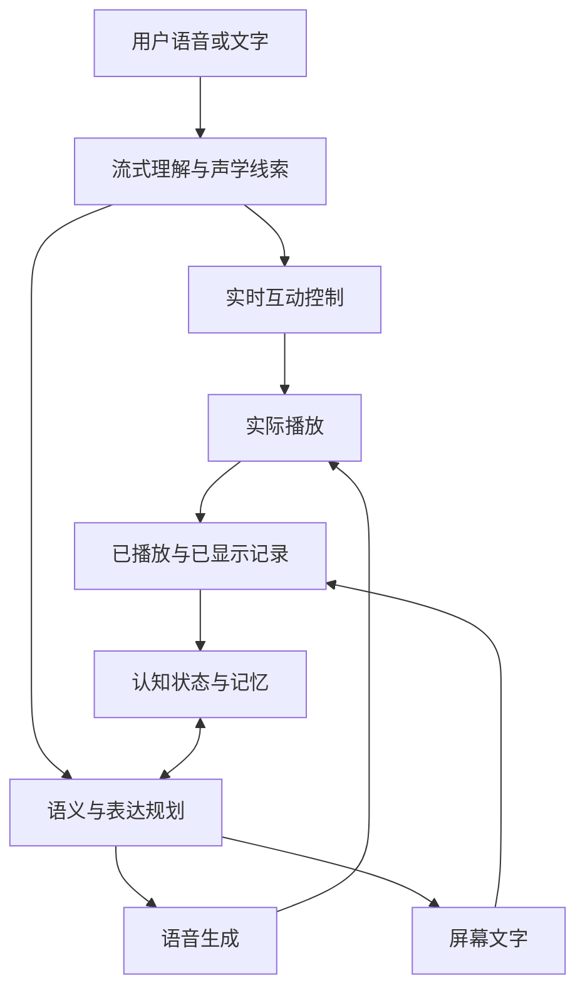

# 小夏语音与聊天专项：顶会论文、候选架构与 Codex 实验

> v1.1 参考版：本稿保留原研究的机制、数据、阅读范围和候选实验。项目交付是不变量；算法、模型、参数、模块、训练与实验安排均可调整、组合、替换或放弃。旧代码接入点和“第一版”安排是候选建议，不构成施工边界。以项目合同 v1.1 和 README_CODEX_REFERENCE 为准。

更新：2026-11-04。面向小夏的语音与聊天专项。核心清单为 28 篇正式会议论文：27 篇发表于 2023–2026 年，另有 1 篇 ACL 2020 基础工作；其中 11 篇发表于 2026 年。覆盖 ACL、EMNLP、NAACL、ICLR、ICML、NeurIPS、AAAI，ACL Short 单独标明。现有代码、TTS 引擎和模型组合均作为候选，不预设保留。

# 方向判断

小夏值得追求的是：理解对方正在做什么，结合共同经历形成自己的回应，再以连贯的声音和合适的时机说出来。

综合这些论文，我建议把研究重点放在**语义与声音联合表达、持续运行的互动控制，以及由真实对话反馈改善的生成策略**。认知网络提供长期状态和经历，强语言模型负责理解与组织，语音系统保留并表达文字之外的信息。最终实现可以是模块化、混合模型或原生语音模型。

最有分量的机制证据有五组：

1. **保留语义支撑。** OmniFlatten 与 LLaMA-Omni 2 的消融都显示，移除文本相关通路会损害语音回答。它们支持研究文本／语义与声音的耦合接口，而不是把“端到端”理解成必须消灭所有中间表征。[P21](https://aclanthology.org/2025.acl-long.912.pdf)、[P22](https://aclanthology.org/2025.acl-long.709.pdf)

2. **稳定身份与灵活表达分开。** NaturalSpeech 3、PromptTTS 2 和 IndexTTS2 分别研究音色、韵律、内容及描述条件的解耦。小夏可以保持同一声音，同时让重音、语速、停连和情绪强度随语境变化。[P10](https://proceedings.mlr.press/v235/ju24b.html)、[P11](https://proceedings.iclr.cc/paper_files/paper/2024/hash/fed1ea8dcc2a13f3835cc854e8c8294c-Abstract-Conference.html)、[P13](https://ojs.aaai.org/index.php/AAAI/article/view/40820)

3. **互动时机需要独立学习。** Talking Turns 定义互动事件；Multi-Faceted Interactivity Alignment 对等待、接话、附和、插话分别优化。这是实时对话能力的一条直接训练路径。[P19](https://proceedings.iclr.cc/paper_files/paper/2025/hash/82f68b38747c406672f7f9f6bab86775-Abstract-Conference.html)、[P17](https://aclanthology.org/2026.emnlp-main.2331/)

4. **自然聊天依赖语境适切性。** SCONPOS 处理人设过用，DialogGRPO 学习有价值的澄清，SODA 用具体情境生成社交对话，EmoCharacter 检查情绪是否由经历与当前事件驱动。[P01](https://aclanthology.org/2026.emnlp-main.2029/)、[P02](https://aclanthology.org/2026.emnlp-main.1370/)、[P03](https://aclanthology.org/2023.emnlp-main.799/)、[P04](https://aclanthology.org/2025.naacl-long.316/)

5. **评价对象必须包含完整交互。** 声音表达用音频盲听，多轮语义用状态与约束检查，抢话和打断用连续双向流。各项各有判据，共同决定路线选择。[P18](https://aclanthology.org/2026.acl-short.4/)、[P26](https://aclanthology.org/2026.acl-long.1654/)、[P27](https://aclanthology.org/2026.acl-long.1615/)

# 三条候选路线

| 路线 | 工作方式与优势 | 最需要验证的能力 | 第一轮研究对象 |
| --- | --- | --- | --- |
| A 强语言模型加可控语音 | 文字、声学线索、记忆共同进入强 LLM；语音独立生成；实时控制并行运行。模型与声音可分别升级 | 语气信息传递是否充分；分句是否自然；推理与 TTS 的合计等待 | 相同强 LLM，比较 IndexTTS 系列、F5 类分句生成及真正流式解码 |
| B 语义与语音耦合 | 语音编码器连接语言底座，文字与隐藏表示共同驱动流式声音；保留明确语义支撑 | 能否兼顾复杂回应、细腻表达、固定声音和低等待 | Freeze-Omni、LLaMA-Omni 2 双语版本；开放模型内部接口的适配实验 |
| C 原生全双工 | 模型持续接收和生成音频，在时间序列上学习听、说、附和与让话 | 中文与中英混合、长期状态、声音身份，以及多人声重叠时的语义保持 | Moshi／PersonaPlex 及四轴 RL checkpoint；GLM-4-Voice 作语音知识对照；OmniFlatten 作训练设计参考 |

**我的研究优先级：重点验证 B 的语义—语音耦合机制，同时让 A 提供强内容与声音控制的基准，让 C 充分展示实时互动优势。** 三条路线都保留获选资格。能力评估先允许各模型发挥其原生能力；随后再统一部署预算与延迟约束，决定产品采用哪条。

这三条是实验原型，不是互斥的理论类别：全双工描述互动方式，语义耦合描述表示与训练设计；B 可以扩展为全双工，C 也可以保留文本流。语义支撑可以是文字、连续隐藏表示或联合 token，具体形式由实验决定，无需规定每轮先写完一整段文字。

B 的 hidden-state 版本需要模型内部表示及适配训练；只有文字 API 的“文本／表达意图＋语音”实验属于另一种可测接口，应分别报告。C 中部分公开模型主要面向英语，应先用中文实测判断。大型预训练工作的价值在于架构与现有 checkpoint，不要求小夏重做其全部训练。

# 认知网络如何进入聊天和声音

建议分清四种状态，它们可以在一个模型内部实现，也可以由多个组件承载：

| 状态 | 应提供的信息 | 应影响的行为 |
| --- | --- | --- |
| 长期认知状态 | 自身稳定倾向、关系经历、已经形成的观点、用户目标和记忆来源 | 什么值得注意、如何理解这次交流、哪些经历自然相关 |
| 当前互动状态 | 用户是在分享、玩笑、求助、纠正还是转题；是否仍在说话；哪些话题尚未完成 | 此刻是否回应、回应重点、是否追问、是否先听 |
| 表达意图 | 这句话是解释、安慰、调侃、认真提醒还是简短回应 | 措辞、重音、节奏、情绪强度和停连 |
| 交付状态 | 哪些文字已显示、哪些音频已播放、哪些内容被打断而未送达 | 后续续聊、纠正、记忆更新与播放取消 |

内部情绪和外显语气需要一个可学习的映射。例如关心对方，可能表现为轻声询问，也可能表现为简短而明确的建议。把内部“关心强度”直接换成统一的柔声标签，会丢掉交际意图。

下面表示能力关系，不规定服务数量或进程划分：

文字与音频应使用同一套版本化状态归并规则；识别假设、用户表达、系统计划和实际呈现分别记录，识别中的每次局部改写不直接更新长期记忆。两种输出保留各自交付记录：用户打断时，已生成但尚未播出的半段回答，不能在下一轮被当成已经通过语音讲完。如果文字已经显示，则保留它的文字交付事实。这是本专项建议加入的工程机制。

实时互动控制只决定等待、附和、接话、让话和取消等时机，不替语言模型预先编写每类情绪的固定句式。表达计划可以保留自然语言描述；只有需要精确执行的发音、片段边界、播放代次等内容才结构化。

# 聊天生成与长期承接

以下研究卡均区分论文机制、论文实验和建议给小夏做的迁移实验。数字用于理解原实验，不用于跨论文排模型名次。

## P01｜人格适切性：SCONPOS

**Controlling and Assessing Appropriate Persona Use in LLM-based Dialogue Generation — EMNLP 2026 主会。** [出版页](https://aclanthology.org/2026.emnlp-main.2029/) · [全文](https://aclanthology.org/2026.emnlp-main.2029.pdf) · [代码](https://github.com/LIK9/SCONPOS-PAS)

机制：比较“全部人设”和“当前语境相关人设”的隐藏激活，得到过度使用人设的方向；推理时在特定层减去该方向，模型权重保持冻结。实验中，人评人格使用适切性胜率为 76%，连贯性为 68%，每组 50 对回复、3 位评审。其自动 PAS 指标与人评相关性较弱，不适合独立裁决体验。

**小夏实验：** 完整人设常驻、稳定身份＋相关经历激活、开权重 activation steering 三组对照。既测不抢着介绍自己，也测被问到时仍有稳定观点。steering 需要内部激活访问；语境化记忆组织则可用于 API 模型。

阅读：§2–5，表 2/3/6/7，附录 B/C。

## P02｜有价值的追问：DialogGRPO

**Don’t Guess, Ask Wisely: Benchmarking and Training Proactive Elicitation in Open-Domain LLM Conversations — EMNLP 2026 主会。** [出版页](https://aclanthology.org/2026.emnlp-main.1370/) · [全文](https://aclanthology.org/2026.emnlp-main.1370.pdf)

机制：从完整请求构造信息缺失版本，离线展开候选追问；以信息增益、后续回答收益和交互成本训练提问策略。Qwen3.5-27B 在完整请求上仍追问的比例为 5.2%，简单“鼓励追问”提示为 42.8%；在两类模糊请求上则积极补齐信息。实验主要使用英文请求和模拟用户。

**小夏实验：** 区分真正好奇、必要澄清、重复询问和机械续聊。优化“问完是否让交流更好”，不要优化提问数量。分享、玩笑和观点交流另设标准，不统一变成信息收集任务。

阅读：§3.3–5.2，表 2/3及消融。

## P03｜情境化社交数据：SODA

**SODA: Million-scale Dialogue Distillation with Social Commonsense Contextualization — EMNLP 2023 主会。** [出版页](https://aclanthology.org/2023.emnlp-main.799/) · [全文](https://aclanthology.org/2023.emnlp-main.799.pdf) · [作者项目](https://hyunw.kim/sodaverse)

机制：社会常识关系生成具体情境，再生成多轮对话；150 万条对话用于训练 COSMO，训练中随机丢弃部分情境与角色提示。未见 DailyDialog 上，COSMO-3B 相对 Vicuna-7B 的自然度人评胜率为 58%。重点是数据构造方法，不是沿用旧模型排名。

**小夏实验：** 用事件、关系、各自掌握的信息、各自在意的事情生成中文场景；同场景比较自然接话、客服建议、机械共情、过度解释。把自然性放进训练与偏好数据，而不只写“请自然一点”。

阅读：§2–5，表 5–7及人评设置。

## P04｜情绪随事件变化：EmoCharacter

**EmoCharacter: Evaluating the Emotional Fidelity of Role-Playing Agents in Dialogues — NAACL 2025 主会。** [出版页](https://aclanthology.org/2025.naacl-long.316/) · [全文](https://aclanthology.org/2025.naacl-long.316.pdf)

机制：以《老友记》剧本构造角色对话，评价情绪一致性、角色差异与情绪转移，并实验情绪—回复联合微调。GPT-4o 无角色提示的情绪一致性为 .484，加入 RoleLLM 提示后为 .422；Llama3-8B 通过联合样本微调由 .408 提升到 .499。研究对象是文本角色与情绪标签。

**小夏实验：** 固定人格，改变当前事件；固定事件，改变共同经历。检查情绪变化是否有来由。“温柔”不要求永远柔声，“乐观”也不要求遇到坏事立刻积极总结。

阅读：§3–5，表 2–5。

## P05｜对话偏好评价：AMULET

**AMULET: Putting Complex Multi-Turn Conversations on the Stand with LLM Juries — EMNLP 2025 主会。** [出版页](https://aclanthology.org/2025.emnlp-main.1300/) · [全文](https://aclanthology.org/2025.emnlp-main.1300.pdf)

机制：分别按对话行为和会话准则评判候选，交换候选顺序双投票，分歧时再裁决。GPT-4o 的偏好判别准确率在 HH-TEST 由 55.7% 到 64.1%，WildFeedback 由 75.1% 到 80.2%。它评价多轮历史末尾的一对候选回复。

**小夏实验：** 用于离线回归和偏好样本筛选，检查回复是否接住分享、求助、纠正或玩笑。行为标签用于评价，不规定固定句式；实时语音不必额外串行经过一组裁判。

阅读：§2–4，表 2–4。

## P06｜记忆索引与原始证据：LongMemEval

**LongMemEval: Benchmarking Chat Assistants on Long-Term Interactive Memory — ICLR 2025。** [出版页](https://proceedings.iclr.cc/paper_files/paper/2025/hash/d813d324dbf0598bbdc9c8e79740ed01-Abstract-Conference.html) · [全文](https://arxiv.org/html/2410.10813v2) · [代码](https://github.com/xiaowu0162/LongMemEval)

机制：分解索引、检索、读取；用抽取事实增强轮次检索 key，保留原始轮次作为证据，结合时间查询。其事实增强索引使 Recall@10 从 .692 到 .784，问答成绩从 .670 到 .720。单纯替换原文为摘要会损失细节。

**小夏实验：** 摘要检索与“浓缩索引＋可读回原对话”比较；覆盖偏好更新、时间指代、玩笑、说话人归属。自然遗忘可以表现为激活降低和细节降级；被检索出来的记忆保留其来源。

阅读：§4–5，表 3/4，附录 D/E。

## P07｜无提示的认知记忆：Locomo-Plus

**Locomo-Plus: Beyond-Factual Cognitive Memory Evaluation Framework for LLM Agents — ACL 2026 主会。** [出版页](https://aclanthology.org/2026.acl-long.1150/) · [全文](https://aclanthology.org/2026.acl-long.1150.pdf) · [代码](https://github.com/xjtuleeyf/Locomo-Plus)

机制：较早对话给出目标、状态、价值或因果背景，之后用词面不相似的话题触发，按相关约束是否被遵守评价。实验中 GPT-4o 的事实记忆平均分 62.99，认知记忆为 21.05；纯语义 top-5 检索仍有明显困难。

**小夏实验：** 看她能否在没被提醒“你记得吗”时自然用到相关经历；同时加入目标已改变的配对反例。评价该关联时关联、不相关时不翻旧账。

阅读：§3–6，表 1–3。

## P08｜人格、知识、共情的融合：BlendedSkillTalk

**Can You Put it All Together: Evaluating Conversational Agents’ Ability to Blend Skills — ACL 2020 主会，经典基础。** [出版页](https://aclanthology.org/2020.acl-main.183/) · [全文](https://aclanthology.org/2020.acl-main.183.pdf)

机制：联合训练人格、知识与共情，再用混合技能真人对话微调；与单技能、切换和路由方案比较。真人总体质量评分，单技能约 2.6–3.0/5，联合训练并 BST 微调达到 3.6/5。模型属于当时的检索式系统。

**小夏实验：** 一段对话里顺畅地聊兴趣、表达心情、解释知识、开玩笑，仍保持同一交流风格。借鉴融合能力的训练目标和数据组织，不照搬 2020 年模型。

阅读：§3–4，表 4/5/7。

# 声音身份与自然表达

## P09｜可变化的表达风格：StyleTTS 2

**StyleTTS 2: Towards Human-Level Text-to-Speech through Style Diffusion and Adversarial Training with Large Speech Language Models — NeurIPS 2023 主会。** [出版页](https://papers.nips.cc/paper_files/paper/2023/hash/3eaad2a0b62b5ed7a2e66c2188bb1449-Abstract-Conference.html) · [全文](https://papers.nips.cc/paper_files/paper/2023/file/3eaad2a0b62b5ed7a2e66c2188bb1449-Paper-Conference.pdf) · [代码](https://github.com/yl4579/StyleTTS2)

机制：文本条件下生成风格向量，声学风格和韵律分别编码，用语音语言模型特征构造判别器。LJSpeech 域外文本消融中，去除风格扩散使自然度 CMOS 降 .46，去除韵律编码器降 .35。

**小夏实验：** 同一身份下比较相邻五句话的韵律变化、自然度和风格连续性。既避免机械重复，也避免每句像换了一个人。公开模型主要是英语，中文适配单独计入方案。

阅读：§3.2、§4、§5.2–5.3。

## P10｜音色、韵律、内容解耦：NaturalSpeech 3

**NaturalSpeech 3: Zero-Shot Speech Synthesis with Factorized Codec and Diffusion Models — ICML 2024。** [出版页](https://proceedings.mlr.press/v235/ju24b.html) · [作者全文](https://arxiv.org/html/2403.03100v3)

机制：FACodec 分离内容、韵律、音色和声学细节，通过信息瓶颈、监督、梯度反转及细节 dropout 学到分工；生成器分别建模。去掉 factorization 后，Sim-O 从 .67 降到 .55，WER 从 1.81 到 2.49，SMOS 从 4.01 到 3.59。实验使用 60K 小时英语训练。

**小夏实验：** 固定音色表示，改变韵律、内容或时长，检测独立控制是否成立。创建几个字段只是接口设计，真正解耦还要模型表示与训练支持。官方公开 FACodec；完整生成路线需另做集成与训练核验。

阅读：§3、§4.1/4.3，附录 A.5–A.6。

## P11｜自然语言控制声音：PromptTTS 2

**PromptTTS 2: Describing and Generating Voices with Text Prompt — ICLR 2024。** [出版页](https://proceedings.iclr.cc/paper_files/paper/2024/hash/fed1ea8dcc2a13f3835cc854e8c8294c-Abstract-Conference.html) · [全文](https://proceedings.iclr.cc/paper_files/paper/2024/file/fed1ea8dcc2a13f3835cc854e8c8294c-Paper-Conference.pdf) · [作者项目](https://speechresearch.github.io/prompttts2/)

机制：将提示明确指定的属性与未指定的变化分开，后者由 diffusion variation network 建模，条件经 cross-attention 进入声音生成。在 1,305 条英语提示上，性别、速度、音量、音高平均控制准确率为 93.33%，对照为 91.54%。

**小夏实验：** “小声一点”“轻一点”等同意图改写应产生接近的表达；未要求变化的声音身份保持稳定。该机制需要相应条件模块训练，本轮未核到完整官方可部署权重。

阅读：§3.1–3.3、§4、§5.1–5.3。

## P12｜连续情绪强度：EmoKnob

**EmoKnob: Enhance Voice Cloning with Fine-Grained Emotion Control — EMNLP 2024 主会。** [出版页](https://aclanthology.org/2024.emnlp-main.466/) · [全文](https://aclanthology.org/2024.emnlp-main.466.pdf) · [作者项目](https://emoknob.cs.columbia.edu/)

机制：从同说话人情绪/中性样本的 embedding 差学习方向，向目标条件加上连续强度的偏移。无需重训，但要访问 embedding。23 位听者的实验中，六类情绪强度辨别平均为 86%；不同情绪的有效性差异很大，增大强度也会影响发音与身份保持。

**小夏实验：** 扫描低强度区间，分别评价温和、轻微高兴、迟疑和认真。目标是语境合适、自然可察觉，而不是情绪分类器分数最大。

阅读：§3–5。

## P13｜固定声线与情绪分离：IndexTTS2

**IndexTTS2: A Breakthrough in Emotionally Expressive and Duration-Controlled Auto-Regressive Zero-Shot Text-to-Speech — AAAI 2026 主会。** [出版页](https://ojs.aaai.org/index.php/AAAI/article/view/40820) · [正式 PDF](https://ojs.aaai.org/index.php/AAAI/article/download/40820/44781) · [作者全文](https://arxiv.org/html/2506.21619v2) · [官方实现](https://github.com/index-tts/index-tts)

机制：音色和情绪参考分开编码，通过梯度反转抑制身份信息泄漏；将 GPT latent 融入声音生成，帮助强情绪时保持清晰。情绪测试中，去掉 GPT latent 的 WER 从 1.883% 升至 2.766%。

**小夏实验：** 固定声音，比较情绪参考音频、自然语言描述、向量强度控制。选择平静关心、克制高兴、稍有犹豫等日常状态。AAAI 论文对应 v2；当前仓库的 v2.5 是后续版本。v2 发布时未启用的时长能力，不能从论文标题直接算作当时的现成功能。

阅读：T2S、三阶段训练、S2M、T2E、实验表 2/3。正式元数据由 AAAI 索引核实，方法读取作者全文。

## P14｜非自回归语音生成：F5-TTS

**F5-TTS: A Fairytaler that Fakes Fluent and Faithful Speech with Flow Matching — ACL 2025 主会。** [出版页](https://aclanthology.org/2025.acl-long.313/) · [全文](https://aclanthology.org/2025.acl-long.313.pdf) · [官方实现](https://github.com/SWivid/F5-TTS)

机制：flow matching 与 DiT 生成声音，ConvNeXt 细化文本表示以改善对齐，Sway Sampling 调整采样步分布。LibriSpeech-PC 上，16 步时 WER 2.53%、RTF .15；32 步时 WER 2.42%、RTF .31。RTF 来自 RTX 3090 生成 10 秒音频的总耗时比例。

**小夏实验：** 比较短句、完整语义分句和长段生成；同时测首音、语义停连、漏字、句间接缝及总耗时。RTF .15 不能直接换算成首音 150 ms。官方有中英权重；代码与权重许可不同。

阅读：§3.1–3.2、§5.1、表 1及采样分析。

## P15｜声音上下文连续性：VoiceCraft

**VoiceCraft: Zero-Shot Speech Editing and Text-to-Speech in the Wild — ACL 2024 主会。** [出版页](https://aclanthology.org/2024.acl-long.673/) · [全文](https://aclanthology.org/2024.acl-long.673.pdf) · [官方实现](https://github.com/jasonppy/VoiceCraft)

机制：用 causal masking 重排语音 token，结合前后声音补全局部内容，以 delayed stacking 处理 codec 层。310 条真实编辑样本中，自然度 MOS 为 4.03，对照为 3.81，原音为 4.17；编辑实验包含十候选筛选的计算预算。

**小夏实验：** 借鉴声学上下文条件化，比较新句是否承接上一段实际播放的声音、打断后重新表达是否连续。论文模型主要面向英语，双向补全机制与实时因果流式输出应分别实现和测试。

阅读：§3、§5.1/5.3/5.4。

## P16｜针对发音失败的偏好学习

**Advancing Zero-shot Text-to-Speech Intelligibility across Diverse Domains via Preference Alignment — ACL 2025 主会。** [出版页](https://aclanthology.org/2025.acl-long.598/) · [全文](https://aclanthology.org/2025.acl-long.598.pdf) · [作者项目](https://intalign.github.io/)

机制：用同模型多采样、跨模型比较和知识引导扰动构造偏好对，分别适配 AR、flow matching 和 masked generation 的 DPO。F5-TTS 四类测试平均 WER 从 17.78 降到 9.62，同时声纹相似度从 .615 到 .591；训练采用 8 张 H100。

**小夏实验：** 收集人名、多音字、数字、否定词、中英混合的真实错读与正确对照，再做定向训练。验收同时保留内容、音色和自然度，避免只改善可懂度却改坏声音。

阅读：§3–5，附录 D/F。

# 实时互动与语义语音融合

## P17｜四类互动行为的强化学习

**Multi-Faceted Interactivity Alignment in Full-Duplex Speech Models — EMNLP 2026 主会。** [出版页](https://aclanthology.org/2026.emnlp-main.2331/) · [全文](https://aclanthology.org/2026.emnlp-main.2331.pdf) · [Moshi RL 权重](https://huggingface.co/kyutai/moshika-rl-seamless) · [PersonaPlex RL 权重](https://huggingface.co/kyutai/personaplex-rl-seamless)

机制：从真人双声道对话抽取犹豫停顿、话轮交接、附和、用户插话，分别设计 GRPO 奖励，并加入内容质量约束。Moshi 在 FDB-v1 的插话后响应从 1.377 s 到 .409 s；起点是用户插话说完，终点是系统新回答开口。训练使用 32 张 H100。

**小夏实验：** 先比较公开基础与 RL checkpoint；分别测等待、有效附和、让话、纠正后的回答。客户端停掉旧声音的延迟要另外记录。英语研究权重先用于机制验证，再考察中文迁移。

阅读：§3.2–5。

## P18｜连续双向流测试：Full-Duplex-Bench-v2

**Full-Duplex-Bench-v2: A Multi-Turn Evaluation Framework for Duplex Dialogue Systems with an Automated Examiner — ACL 2026 主会短文。** [出版页](https://aclanthology.org/2026.acl-short.4/) · [全文](https://aclanthology.org/2026.acl-short.4.pdf) · [代码](https://github.com/DanielLin94144/Full-Duplex-Bench)

机制：语音 Examiner 带着阶段目标连续交谈，Fast 主动插话、Slow 等待，测试日常交流、纠正与实体追踪等。统一 WebRTC adapter 可比较不同模型结构。Moshi 实体追踪 Fast 2.76/5、Slow 3.84/5，显示互动节奏会改变内容表现。

**小夏实验：** 复用连续交互测试思想，增加中文日期、对象、指代和连续改口。论文的 48 kHz、16-bit、mono、10 ms 帧是测试协议，产品采样配置可另外决定。增加扬声器与麦克风的真实声学闭环。

阅读：§2.1–2.4、§3及附录。

## P19｜什么时候轮到谁说：Talking Turns

**Talking Turns: Benchmarking Audio Foundation Models on Turn-Taking Dynamics — ICLR 2025。** [出版页](https://proceedings.iclr.cc/paper_files/paper/2025/hash/82f68b38747c406672f7f9f6bab86775-Abstract-Conference.html) · [全文](https://proceedings.iclr.cc/paper_files/paper/2025/file/82f68b38747c406672f7f9f6bab86775-Paper-Conference.pdf) · [实现入口](https://github.com/espnet/espnet/pull/5948)

机制：用历史音频在 40 ms 粒度预测继续、附和、插话、换人、静默等互动事件，模型采用 Whisper 编码器与预测头。它把“声音重叠发生了多少”拆成“这次重叠是否合适”，从而区分支持性附和和抢话。

**小夏实验：** 同一句“嗯”在不同场景可能是附和，也可能表示要说话；短促的“不！”可能是明确纠正。结合语音、时序与语境判断，不用“有人声就取消”或一个固定静音阈值包办互动。

阅读：§3.2、§4.1–4.8、§7及用户研究。

## P20｜冻结语言底座、学习语音接口：Freeze-Omni

**Freeze-Omni: A Smart and Low Latency Speech-to-speech Dialogue Model with Frozen LLM — ICML 2025。** [出版页](https://proceedings.mlr.press/v267/wang25aw.html) · [作者全文 v5](https://arxiv.org/html/2411.00774v5) · [官方实现](https://github.com/VITA-MLLM/Freeze-Omni)

机制：冻结文本 LLM，训练流式音频编码器、适配器与解码器，利用 hidden states、prefix KV-cache 和块级听说状态。Web Questions 语音输入准确率为 44.73%，原文本底座为 45.13%。论文响应统计从进入生成状态计时，端点判断另有耗时。

**小夏实验：** 验证强文本模型的知识与推理能否经学习后的语音接口保持。该方案需要内部表示；训练用到大量内部 ASR 数据和合成语音，优先研究现成权重与小规模适配，不安排重做全部预训练。

阅读：作者版 §2、§3.1/3.4/3.5；会场由正式出版页核实。

## P21｜文本与隐藏状态门控：LLaMA-Omni 2

**LLaMA-Omni 2: LLM-based Real-time Spoken Chatbot with Autoregressive Streaming Speech Synthesis — ACL 2025 主会。** [出版页](https://aclanthology.org/2025.acl-long.912/) · [全文](https://aclanthology.org/2025.acl-long.912.pdf) · [官方实现](https://github.com/ictnlp/LLaMA-Omni2)

机制：LLM hidden states 与实际采样的文字 token embedding 门控融合，按读写块流式生成声音。去掉文字 embedding 后，ASR-WER 从 3.26 到 6.83，语音回答分从 4.15 到 3.88。7B 在单 L40 上首语音块为 582.91 ms。

**小夏实验：** 研究中文语义完整性与流式表达，分别比较明确文字、隐藏状态及二者联合的作用。仓库现有 0.5B–32B 双语版本，论文原表主要对应英语版本。流式输出与持续监听、让话需要分项验证。

阅读：§2–5，重点消融表。

## P22｜统一时间序列的全双工：OmniFlatten

**OmniFlatten: An End-to-end GPT Model for Seamless Voice Conversation — ACL 2025 主会。** [出版页](https://aclanthology.org/2025.acl-long.709/) · [全文](https://aclanthology.org/2025.acl-long.709.pdf) · [作者演示](https://omniflatten.github.io/)

机制：把用户音频、助手文字、助手音频分块交错为一个序列，逐步训练模态对齐、半双工和全双工。在相同 0.5B 设置中，三流版本英语/中文回答评分为 3.92/5.15（十分制）；去掉助手文字变为 2.19/3.06。

**小夏实验：** 保留语义支撑的原生双工与其他表示做对照。这个消融说明特定训练配置里的文本流有用，并不要求所有候选都先写完文字再说话。作者演示可读，本轮未核到正式模型与训练代码发布。

阅读：§3–4，表 3/4。

## P23｜让语音调用文本知识：交错预训练

**Scaling Speech-Text Pre-training with Synthetic Interleaved Data — ICLR 2025。** [出版页](https://proceedings.iclr.cc/paper_files/paper/2025/hash/7b5ae891000049b91b3b62de596b1560-Abstract-Conference.html) · [全文](https://proceedings.iclr.cc/paper_files/paper/2025/file/7b5ae891000049b91b3b62de596b1560-Paper-Conference.pdf) · [GLM-4-Voice 实现](https://github.com/zai-org/GLM-4-Voice)

机制：ASR 监督语音 tokenizer，直接合成 speech token，交错文本与语音训练以打通知识使用。9B 在 Llama Questions 的 S2S 准确率为 50.7%，移除交错数据后为 2.3%。训练总量为 1T token，其中 600B 为合成交错数据。

**小夏实验：** 采用公开中英 checkpoint 比较文字通道与语音通道的回答，定位知识是否顺利进入声音。该论文提供预训练机制依据，不建议小夏复刻万亿 token 训练。

阅读：§2.1–2.4、§3.1–3.3。

## P24｜边听边检索：Stream RAG

**Stream RAG: Instant and Accurate Spoken Dialogue Systems with Streaming Tool Usage — ICML 2026。** [出版页](https://proceedings.mlr.press/v306/arora26a.html) · [作者全文 v1](https://arxiv.org/html/2510.02044)

机制：利用用户尚未说完时的输入做预检索；可按间隔查询，也可学习是否查询，缓存结果并在完整请求到来后修正。训练中加入先前错误查询，使模型学会撤销过早理解。正式版与作者 v1 的实验数值有更新，本报告仅采用已读方法，不混用数值。

**小夏实验：** 对相关记忆和只读知识检索做受预算控制的预取；用户后半句改了日期或对象，就更新查询并停止采用旧结果。比较端点后才检索与流式检索的有意义回答等待、工具次数及错误结果使用率。

阅读：作者版 §3–5；正式会场由 PMLR 核实。

# 语气理解与整体评测

## P25｜文字之外的信息：Prosody and Text

**What Do Prosody and Text Convey? Characterizing How Meaningful Information is Distributed Across Multiple Channels — ACL 2026 主会。** [出版页](https://aclanthology.org/2026.acl-long.1085/) · [全文](https://aclanthology.org/2026.acl-long.1085.pdf)

机制：以单句英语情绪和讽刺数据，比较文字与声音分类器，并估计不同通道提供的信息。实验显示，音频携带相当一部分转写未保留的情绪及讽刺线索。任务、上下文长度和分类器影响具体估计，不把其比值外推为普遍规律。

**小夏实验：** 同一文字配不同语调、停顿与重音，比较仅转写、转写加声学表示、直接音频理解。判据是回应是否考虑了有意义的声学线索；有歧义的语气允许多种合理反应，不强制输出唯一情绪标签。

阅读：方法、通道比较与实验讨论。

## P26｜多轮语音中的语义保持：Audio MultiChallenge

**Audio MultiChallenge: A Multi-Turn Evaluation of Spoken Dialogue Systems on Natural Human Interaction — ACL 2026 主会。** [出版页](https://aclanthology.org/2026.acl-long.1654/) · [全文](https://aclanthology.org/2026.acl-long.1654.pdf)

机制：452 段真人英语对话、47 名说话人、约 15 小时，覆盖推理记忆、指令保持、自洽和口头改口，使用细粒度 rubric 评价。协议给模型相同历史用户音频与助手文字，再生成最终回复，因此适合隔离语义问题。

**小夏实验：** 中文“明天……不，后天”、先否定后修改、跨轮约束与口头省略。固定历史回放用于定位问题；连续真人或自适应 Examiner 对话用于检验实际交互，两者同时保留。

阅读：数据构造、四类任务、评测协议及结果。

## P27｜直接评价声音表达：S2S-Arena

**S2S-Arena: Evaluating Paralinguistic Instruction Following in Speech-to-Speech Models — ACL 2026 主会。** [出版页](https://aclanthology.org/2026.acl-long.1615/) · [全文](https://aclanthology.org/2026.acl-long.1615.pdf)

机制：将语义理解、语气感知、声音表达及二者结合分层测试；1,243 条样本包含约四分之一中文，以直接音频成对比较评价。人机裁判一致性约 82.87%；论文的模型集合主要来自 2023–2025 年。

**小夏实验：** 听原始声音分别评内容、语气适切性、自然度与声线；配对评价允许平局。使用其任务分层，不把旧模型排名当作当前选型答案，也不把转写流畅度当作声音自然度。

阅读：任务定义、样本构造、比赛与裁判验证。

## P28｜中文真实口语与跨模态：RealTalk-CN

**RealTalk-CN: A Realistic Chinese Speech Task-Oriented Dialogue Benchmark with Cross-Modal Analysis — ACL 2026 主会。** [出版页](https://aclanthology.org/2026.acl-long.131/) · [全文](https://aclanthology.org/2026.acl-long.131.pdf)

机制：5,400 段中文对话、约 60K 轮、150 小时、113 位说话人，保留口语停顿、重复、自我修正与语气词，并标注时间及任务信息。支持语音、文字交替的分析；录音场景以安静室内为主，任务偏目标导向。

**小夏实验：** 用户语音提要求、文字改口、再用语音追问，检查对象和当前意图是否连续。用此类数据验证中文口语承接，再以自由聊天场景补足陪伴交流的评价。

阅读：数据收集、标注、跨模态协议及实验。

# Codex 首轮实验

下面是建议开展的实验，不是已经跑出的项目结果。先每类用少量场景确认链路，再扩大为完整评测；三条原型使用相同任务、认知状态快照和工具权限。用于消融的配置匹配模型容量与计算预算；另做各路线原生最佳配置比较，保留各自长处。

| 实验 | 建议场景与对照 | 必须读出的结果 |
| --- | --- | --- |
| E1 连续自然聊天 | 24 个场景，每段 15–30 轮；分享、玩笑、观点、求助、纠正、转题混合。比较完整人设与相关状态激活、机械追问与价值导向策略 | 是否接住当前话题；有无自己的有用表达；重复、抢自述和过度追问；整段聊天偏好 |
| E2 相同文字、不同语气 | 40 组配对录音，如“行啊”“没事”“真厉害”，改变重音、停顿、疲惫感、真诚或反讽。比较转写、声学增强和原生音频输入 | 哪些线索改变理解；哪些仍然有歧义；回应是否恰当，而非情绪标签是否更激烈 |
| E3 固定声线、灵活表达 | 32 句话 × 4 类语境；同意图改写，以及连续五句。比较参考音频、文本表达指令、内部条件控制 | 音色身份、表达适切性、自然度、句间连续性分开评；不要只看声纹相似度 |
| E4 真实接话与打断 | 40 个脚本，Fast/Slow 两种节奏；包含犹豫停顿、短附和、真正插话、连续纠正。耳机和外放均测 | 误抢话、误停声、让话成功；回声影响；旧音频实际停止、改口后新回答及内容是否更新 |
| E5 跨会话与跨模态记忆 | 12 个场景，每个 3 次会话；语音说明、文字修改、语音续聊。加入相关历史与已过时目标 | 相关经历自然生效；旧值不继续支配；来源与说话人正确；不过度翻旧账 |
| E6 实际说出的内容 | 60 个中文及中英混合案例，涵盖姓名、数字、多音字、否定、选项和自我纠正 | 推理内容与实际音频分别核验；若有文字输出，再比较文字与说出内容的偏差 |
| E7 流式预检索 | 12 个带后半句改口的请求，比较说完再检索与边听边预取 | 有意义回答等待、查询次数、修订取消、过时结果误用；预取仅针对读取 |

E1/E5 同时采用固定历史回放和真实连续对话。固定回放便于定位差异；实时对话让后续输入随模型真实回答调整。真人盲评以整段交流为主，模型裁判辅助找错误。场景、说话人与会话应分组划分训练/开发/测试，避免相似片段跨集合泄漏。

## 时间与内容如何测

每次会话记录同一条客户端时间轴：

1. 用户当前有效发言结束。

2. 系统判定可以接话。

3. 附和开始播放（如果有）。

4. 第一个有实质回应的音频开始播放。

5. 用户开始插话。

6. 旧音频实际停止。

7. 用户纠正说完。

8. 采用纠正后的新回答开始播放。

由此分别得到回答等待、附和时机、停旧声延迟和纠正后回答等待。服务端发出取消成功，与扬声器真正停声，是两个测点；“嗯、让我想想”也应与实质回答分开统计。再拆出端点、理解/推理、检索、首音生成、传输、排队和播放耗时，报告样本数、P50/P95、冷/热启动与长会话漂移。

内容核验针对真实音频；自动转写用于定位，数字、否定、名字等关键差异人工复核。声音自然度听原音，不能仅让裁判读转写。保留截断半字、残音、重播、丢帧、错附和和抢话的原始片段。

固定任务和资源后，结果属于该具体配置。记录 checkpoint、语言版本、量化、上下文、认知快照、网络、播放缓冲与设备；每次运行从干净测试状态开始，避免前一模型的实验记忆改变后一模型的输入。最终看内容、自然度、互动、身份、延迟和成本的取舍，不把所有指标揉成一个总分。

## 最小运行接口

先约定必要的信息，不急于规定进程或服务数量：

- 输入事件：时间戳、来源通道、识别假设及修订关系、可用声学表示。

- 生成请求：认知状态版本、当前交流意图、相关经历、待回答内容。

- 表达条件：声音身份、自然语言表达意图、必要的读音提示；韵律细节可由模型学习。

- 输出事件：生成片段、播放代次、已显示范围、已播放范围、取消和完成。

- 反馈事件：针对哪一段、哪一种问题——内容、时机、声音、记忆或发音。

互动控制负责时机，语言模型负责形成回应。模型内部可以联合完成这些能力；接口的作用是让实验可观测、输出能取消、状态能连续，而不是将聊天拆成固定模板流水线。

# 候选实现与训练投入

| 研究对象 | 现阶段可采用的材料 | 适合的角色 |
| --- | --- | --- |
| IndexTTS 系列 | 官方推理、声线与情绪分离接口；当前 v2.5 为后续工程版本，使用自定义模型许可 | 中文固定声音与表达控制的候选 |
| F5-TTS | 官方中英权重与推理；代码 MIT，公开权重 CC-BY-NC | 非自回归生成与分句策略对照 |
| LLaMA-Omni 2 | 官方双语 0.5B–32B 系列；代码 Apache-2.0，公开模型学术非商用 | 语义—语音耦合研究 |
| Freeze-Omni | 官方代码与模型材料；需要底座内部表示 | 冻结强语言底座的语音适配研究 |
| Moshi／PersonaPlex 四轴 RL | 论文作者发布的英语研究 checkpoint，卡片含非商用条件 | 互动策略与原生双工对照 |
| GLM-4-Voice | 中英 tokenizer、9B、decoder 与推理材料 | 文本知识进入语音通道的对照 |
| NaturalSpeech 3／PromptTTS 2／OmniFlatten | 分解表示、控制、训练与消融证据；开放程度各异 | 机制设计与后续训练依据 |

已通过 GitHub 读取 [IndexTTS README](https://github.com/index-tts/index-tts/blob/main/README.md)、[F5-TTS README](https://github.com/SWivid/F5-TTS/blob/main/README.md)、[LLaMA-Omni 2 README](https://github.com/ictnlp/LLaMA-Omni2/blob/main/README.md)。其余开放信息来自本轮作者页面与论文。正式模型版本、语言与许可在实际实验记录中固定，论文版本与后续工程版本分别标注。

你的 RTX 5070 Ti 16 GB、64 GB 内存可以作为一个具体部署测试点；本报告没有在这台设备跑模型，也不据参数量直接宣称整条路线能装下。先明确研究能力上限，再比较本机、远程推理及混合部署的实际成本与延迟。

## 反馈怎样形成持续改进

第一层是运行状态与记忆：一次纠正应立即改变当前理解和后续承接。

第二层是表达选择：积累同情境下的偏好，例如自然接话优于客服总结、有价值追问优于重复确认、克制表达优于夸张表演。可用于上下文组织、候选排序或小模型策略学习。

第三层是模型后训练：当错误模式稳定、样本可复现时，再对聊天策略、语音适配器或声学模型做定向 LoRA／偏好优化。不同错误分别处理：发音错不必改整个人格，停声慢应先定位交互与播放链路，记忆选错则检查相关性与时间语义。

反馈要带场景和原因。用户嫌某次回复啰嗦，学到的是该情境下表达过长；不应被更新成“以后永远只说一句”。持续学习的目标是更细致地选择，而不是越来越僵硬。

# 交付顺序与 Codex 任务

**第一步：建立共用实验与观测。** 固定任务、认知快照、音频输入、客户端测点和人工盲评方法；现有实现成为一个可重复基准。

**第二步：各做一条最小可运行原型。** A 测强内容与可控声音，B 测内部语义／声音连接，C 测持续互动。每条允许原生能力发挥，声线保持作为被测能力，不强迫全部接同一外部 TTS。

**第三步：按问题做消融。** 优先回答：声学线索是否提高理解？语义支撑是否改善说出内容？表达控制是否稳定声音？互动学习是否减少抢话与误停？记忆是否在需要时自然生效？

**第四步：据证据确定主线与训练目标。** 可能选择单一路线，也可能吸收 B 的语义接口与 C 的互动策略。保留能够支持结论的原始音频、事件时间轴和配对评审；在失败类别明确后安排训练投入。

可直接交给 Codex 的任务说明：

> 以本专项 28 篇论文为机制依据，开展小夏语音与聊天的架构实验。现有目录、引擎、模型与串行流程均可替换；论文提供假设与可复现实验，不规定必须复制其模块划分。  
>   
> 比较强语言模型加可控语音、语义与流式语音耦合、原生全双工三组原型。允许不同中间表示；分别标注是否保留副语言信息、如何组织语义、生成中是否持续监听、能否按用户意图让话。  
>   
> 每个实验写清论文来源、迁移假设、对照配置、客户端测点、质量标准与结果。研究自然聊天、固定声线表达、有效追问、口头纠正、跨模态记忆，以及真实外放情况下的接话和打断。  
>   
> 交付可复现实验清单、配置版本、场景与音频、事件日志、盲评结果和主线建议。结果应说明哪种配置在什么任务与资源下更好；把未达到的能力定位到理解、推理、表达、互动或运行链路，再决定下一步训练与实现。

# 阅读与版本说明

本报告核对了 28 篇正式会议出版信息，并阅读其方法、实验、关键消融或评测协议。研究卡给出实际阅读范围；工程方案、接口和实验规模为结合论文后提出的小夏设计建议。

NaturalSpeech 3、Freeze-Omni、LongMemEval、Stream RAG 和 IndexTTS2 的部分方法阅读采用链接所示作者全文版本；会场由正式出版页核实。Stream RAG 不混用预印本与正式版数值。Moshi 等模型名称可作为研究底座出现，但未把未核实会场的技术报告加入 28 篇正式论文数量。

与前序研究的衔接：[小夏统一架构与实现路线](https://chatgpt.com/space/page_d5ae701869608191aa3fe2ad06334c81)。本专项扩展语音和聊天能力，允许实验结果反过来调整原来的整体方案。

